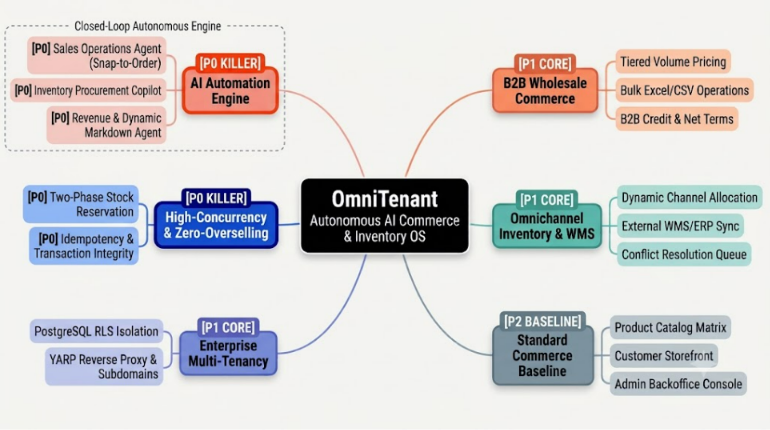
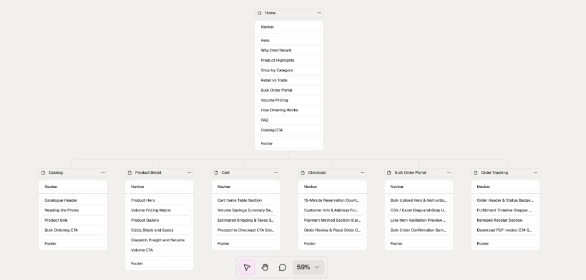
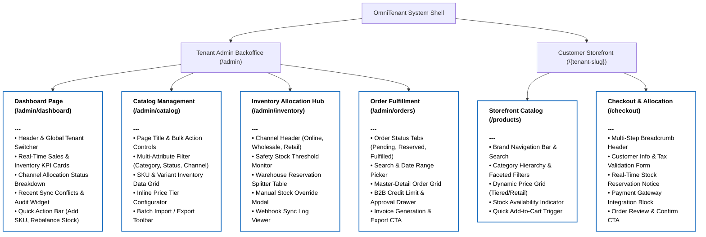
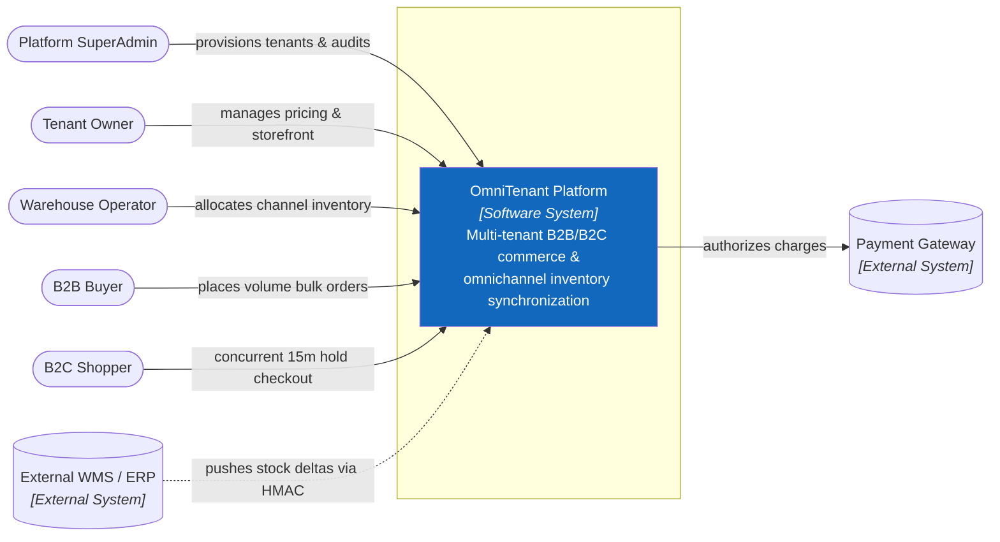
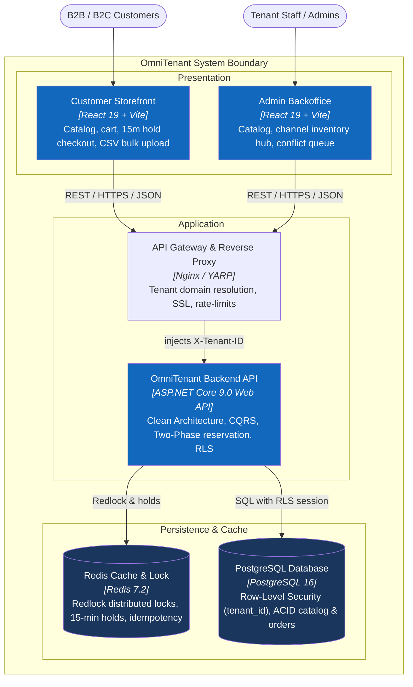
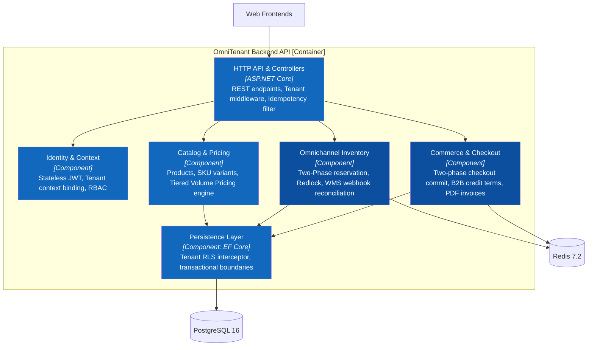
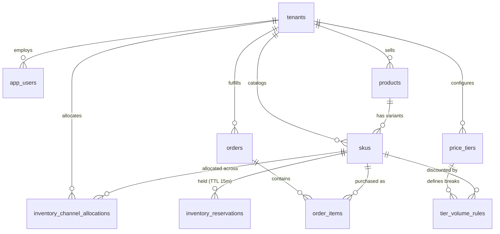

# OmniTenant — Autonomous AI Commerce & Inventory Operating System

OmniTenant is an enterprise multi-tenant commerce and omnichannel inventory operating system powered by a **Tri-Agent Closed-Loop AI Automation Engine**. It enables brand owners and distributors to manage isolated storefronts, execute instant **Snap-to-Order AI B2B purchase order parsing (Agent 1)**, leverage **autonomous stockout forecasting & replenishment (Agent 2)**, automate **dead-stock liquidation & dynamic markdown campaigns (Agent 3)**, track omnichannel inventory allocations in real time, and handle high-concurrency checkout with zero overselling guarantee and row-level tenant isolation.

## 1. Requirements — INVEST, Use Cases, and Acceptance Criteria

Requirements define the operational scope, actor responsibilities, transactional integrity rules, and observable acceptance criteria for OmniTenant. Backlog items are structured using the INVEST model and validated against high-concurrency business flows.

### 1.1 Product Mind Map & Strategic Feature Hierarchy



#### Strategic Feature Highlights & Differentiators

| Capability Tier | Feature | Technical Depth & Mechanism | WOW Factor / Business Impact |
| :--- | :--- | :--- | :--- |
| **P0 Killer (AI)** | **AI Snap-to-Order (Agent 1)** | Multimodal Vision + LLM entity extraction; Trigram/vector fuzzy match into scoped tenant SKUs; real-time volume tier pricing calculation. | **3 seconds vs 15 minutes:** Eliminates manual data entry for handwritten notes and B2B purchase orders. |
| **P0 Killer (AI)** | **Inventory Copilot (Agent 2)** | 30-day rolling burn-rate modeling; dynamic runway prediction ($\frac{\text{Stock}}{\text{BurnRate}}$); automatic restock PO drafting with lead times. | **Zero Stockouts:** Proactively detects stockout risk days before depletion and prepares supplier orders automatically. |
| **P0 Killer (AI)** | **Dead-Stock Liquidation (Agent 3)** | Scans stagnant inventory (>30d, velocity drop >50%); models price elasticity with 10% margin floor guard; scheduled auto-rollback. | **Capital Recovery:** Automatically unlocks trapped working capital via scheduled flash sales without margin erosion. |
| **P0 Killer (Tech)** | **Two-Phase Concurrency Control** | Distributed Redis Redlock (~10ms) $\rightarrow$ Optimistic version check $\rightarrow$ 15-min TTL reservation hold $\rightarrow$ Auto-reaper cleanup. | **Zero Overselling Guarantee:** Prevents overselling during high-concurrency flash sales with 10,000+ simultaneous checkout requests. |
| **P1 Foundation** | **Row-Level Security (RLS)** | PostgreSQL native RLS policy `USING (tenant_id = current_setting('app.current_tenant_id'))`. | **Mathematical Data Sandboxing:** Cross-tenant leakage is structurally impossible even if developers forget `WHERE` clauses. |


### 1.2 INVEST Requirements

The V1 scope includes 21 core user stories spanning multi-tenant authentication, dynamic catalog management, distributed inventory tracking, B2B wholesale orders, high-concurrency B2C checkout, webhook synchronization, administrative audit trails, and closed-loop multi-agent automation. Each user story is evaluated and refined against the INVEST criteria before implementation.

| Criterion | Meaning in OmniTenant |
| :--- | :--- |
| **Independent** | Feature stories, such as catalog browsing and order checkout, are decoupled through well-defined domain events and boundaries. |
| **Negotiable** | Cart storage engines and inventory reservation backends, such as Redis or database locks, can vary as long as consistency contracts hold. |
| **Valuable** | Each capability delivers tangible business outcomes, including multi-tenant isolation, inventory overselling prevention, B2B volume pricing, and automated AI order intake. |
| **Estimable** | Data access boundaries, idempotency keys, isolation requirements, and rollback behaviors are documented. |
| **Small** | Complex workflows, such as two-phase checkout and multimodal PO extraction, are decomposed into discrete API, locking, persistence, and event-dispatch tasks. |
| **Testable** | Every story maps to measurable acceptance criteria covering race-condition behavior, RBAC constraints, and tenant boundary enforcement. |

#### V1 User Story Overview

```text
US01–US02    Platform & Tenant Authentication (JWT, Tenant Context)
US03         Tenant Onboarding & Domain Provisioning
US04–US06    Multi-Tenant Catalog Management (SKUs, Variants, Attributes)
US07–US09    Real-Time Inventory Allocation & Channel Reservations
US10–US12    B2B Wholesale Ordering & Tiered Volume Pricing
US13–US14    B2C High-Concurrency Checkout & Idempotent Payment
US15         Omnichannel Webhook Ingestion & External Inventory Sync
US16         Audit Logging & Distributed Traceability
US17         Tenant User Management & Role-Based Permissions
US18         Merchant Storefront Configuration & Webhook Endpoints
US19         AI Sales Operations Agent: B2B Purchase Order Parsing (Snap-to-Order)
US20         AI Procurement Agent: Stockout Runway Forecast & Auto-Replenishment
US21         AI Revenue Agent: Autonomous Dead-Stock Liquidation & Dynamic Markdown
```

All V1 stories guarantee strong tenant data segregation at the persistence tier through `tenant_id` query scoping, atomic inventory decrement using pessimistic or distributed Redis locks, and idempotency key enforcement on all checkout requests.

Detailed specifications are maintained in the [INVEST Requirements Catalog](docs/08-invest-requirements.md).

### 1.3 Use Cases

The following diagram illustrates the primary actors, their responsibilities, and the use cases supported by OmniTenant.


Detailed preconditions, happy paths, edge cases, and postconditions are documented in the [Use Case Specifications](docs/03-use-cases.md).

### 1.4 Roles and Permissions

| Capability | Platform SuperAdmin | Tenant Owner | Warehouse Operator | B2B Buyer | B2C Shopper |
| :--- | :--- | :--- | :--- | :--- | :--- |
| **Tenant Provisioning** | Yes | No | No | No | No |
| **Manage Tenant Settings & API Keys** | Global view | Yes (Own tenant) | No | No | No |
| **Manage Catalog (Products, SKUs)** | Global view | Yes (Own tenant) | Yes (Own tenant) | No | No |
| **Allocate & Adjust Stock** | No | Yes (Own tenant) | Yes (Own tenant) | No | No |
| **Configure Tiered Pricing** | No | Yes (Own tenant) | No | No | No |
| **Place Orders / Checkout** | No | No | No | Yes (Wholesale tier) | Yes (Retail tier) |
| **Process External Sync Webhooks** | System level | Yes | Yes | No | No |
| **View Audit Logs** | Global audit | Tenant audit | No | No | No |

Tenant isolation is verified at every API boundary. Every authenticated principal context carries a cryptographically validated `TenantId`, which is injected directly into database queries and cache keys to prevent cross-tenant data leakage.

## 2. Information Architecture, Screen Hierarchy, and UI/UX

The Information Architecture maps out the structural layout of both the Backoffice workspace and the Public Storefront. Screen composition follows an explicit block-level anatomy pattern, defining headers, controls, data views, and action triggers for each operational interface.

### 2.1 Information Architecture

The following sitemap illustrates the visual information architecture, page hierarchy, and block-level section composition across the OmniTenant storefront:



### 2.2 Screen Hierarchy

The following diagram illustrates the architectural hierarchy of the OmniTenant platform, including the Tenant Admin Backoffice and the Customer Storefront.



Detailed screen IDs, task flows, permissions, UI/UX state contracts, and API mappings are maintained in [Information Architecture & Screen Hierarchy](docs/04-information-architecture.md).

## 3. C4 Architecture

This section documents the C1–C3 architecture views of the OmniTenant platform.

### C1 — System Context



### C2 — Container



### C3 — Component



Complete architecture documentation: [C4 Architecture Handbook](docs/architecture/c4/README.md).

## 4. Database Diagrams and OpenAPI 3.0 Contract

### 4.1 Database Diagrams & PostgreSQL Schema

The OmniTenant PostgreSQL model enforces strict multi-tenancy via Row-Level Security (`tenant_id`), two-phase concurrency holds (`inventory_reservations` with 15-minute TTL), B2B volume breaks, and an append-only audit trail.



See the [detailed entity-relationship diagram](docs/DATABASE.md), [data model specification](docs/05-data-model.md), and [PostgreSQL schema DDL](src/database/schema.sql).

### 4.2 OpenAPI 3.0 API Documentation

The HTTP contract is defined with OpenAPI 3.0.3 and organized into Authentication & Tenants, Catalog & SKUs, Wholesale Pricing, Omnichannel Inventory, Checkout & Orders, B2B Bulk Orders, Staff & RBAC, and Analytics & Audit.

```text
30 paths (including Tri-Agent AI Automation: PO extraction, Runway Forecasting & Dead-Stock Liquidation)
41 reusable schemas
Stateless Bearer JWT security (15-min TTL) with tenant context resolution
Strict Idempotency-Key enforcement on mutating checkout & webhook requests
Two-phase stock reservation protocol (Redis Redlock + 15-min hold)
RFC 7807-compatible application/problem+json errors with traceId correlation
```

- [OpenAPI 3.0.3 specification](docs/api/openapi.yaml)
- [API documentation and sample cURL workflows](docs/api/README.md)
