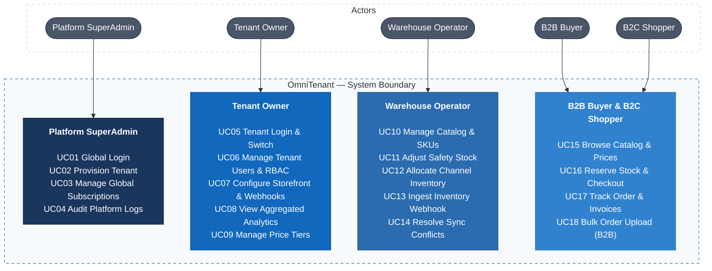
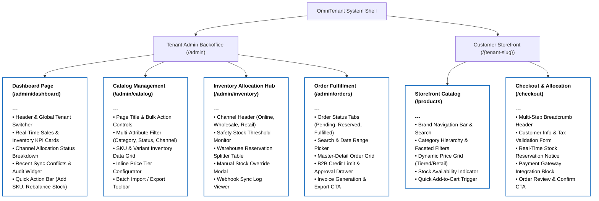

# OmniTenant

OmniTenant is a cloud-native B2B/B2C multi-tenant commerce and inventory synchronization platform. It enables brand owners and distributors to manage isolated storefronts, track omnichannel inventory allocations in real time, execute bulk wholesale orders, and handle high-concurrency checkout with strong data consistency and row-level tenant isolation.

## 1. Requirements — INVEST, Use Cases, and Acceptance Criteria

Requirements define the operational scope, actor responsibilities, transactional integrity rules, and observable acceptance criteria for OmniTenant. Backlog items are structured using the INVEST model and validated against high-concurrency business flows.

### 1.1 Product Mind Map


### 1.2 INVEST Requirements

The V1 scope includes 18 core user stories spanning multi-tenant authentication, dynamic catalog management, distributed inventory tracking, B2B wholesale orders, high-concurrency B2C checkout, webhook synchronization, and administrative audit trails. Each user story is evaluated and refined against the INVEST criteria before implementation.

| Criterion | Meaning in OmniTenant |
| :--- | :--- |
| **Independent** | Feature stories, such as catalog browsing and order checkout, are decoupled through well-defined domain events and boundaries. |
| **Negotiable** | Cart storage engines and inventory reservation backends, such as Redis or database locks, can vary as long as consistency contracts hold. |
| **Valuable** | Each capability delivers tangible business outcomes, including multi-tenant isolation, inventory overselling prevention, and B2B volume pricing. |
| **Estimable** | Data access boundaries, idempotency keys, isolation requirements, and rollback behaviors are documented. |
| **Small** | Complex workflows, such as two-phase checkout, are decomposed into discrete API, locking, persistence, and event-dispatch tasks. |
| **Testable** | Every story maps to measurable acceptance criteria covering race-condition behavior, RBAC constraints, and tenant boundary enforcement. |

#### V1 User Story Overview

```text
US01–US02    Platform & Tenant Authentication (JWT, Tenant Context)
US03         Tenant Onboarding & Domain Provisioning
US04–US06    Multi-Tenant Catalog Management (SKUs, Variants, Attributes)
US07–US09    Real-Time Inventory Allocation & Channel Reservations
US10–US12    B2B Wholesale Ordering & Tiered Volume Pricing
US13–US14    B2C High-Concurrency Checkout & Idempotent Payment
US15         Omnichannel Webhook Ingestion & External Inventory Sync
US16         Audit Logging & Distributed Traceability
US17         Tenant User Management & Role-Based Permissions
US18         Merchant Storefront Configuration & Webhook Endpoints
```

All V1 stories guarantee strong tenant data segregation at the persistence tier through `tenant_id` query scoping, atomic inventory decrement using pessimistic or distributed Redis locks, and idempotency key enforcement on all checkout requests.

Detailed specifications are maintained in the **INVEST Requirements Catalog**.

### 1.3 Use Cases

The following diagram illustrates the primary actors, their responsibilities, and the use cases supported by OmniTenant.



Detailed preconditions, happy paths, edge cases, and postconditions are documented in the **Use Case Specifications**.

### 1.4 Roles and Permissions

| Capability | Platform SuperAdmin | Tenant Owner | Warehouse Operator | B2B Buyer | B2C Shopper |
| :--- | :--- | :--- | :--- | :--- | :--- |
| **Tenant Provisioning** | Yes | No | No | No | No |
| **Manage Tenant Settings & API Keys** | Global view | Yes (Own tenant) | No | No | No |
| **Manage Catalog (Products, SKUs)** | Global view | Yes (Own tenant) | Yes (Own tenant) | No | No |
| **Allocate & Adjust Stock** | No | Yes (Own tenant) | Yes (Own tenant) | No | No |
| **Configure Tiered Pricing** | No | Yes (Own tenant) | No | No | No |
| **Place Orders / Checkout** | No | No | No | Yes (Wholesale tier) | Yes (Retail tier) |
| **Process External Sync Webhooks** | System level | Yes | Yes | No | No |
| **View Audit Logs** | Global audit | Tenant audit | No | No | No |

Tenant isolation is verified at every API boundary. Every authenticated principal context carries a cryptographically validated `TenantId`, which is injected directly into database queries and cache keys to prevent cross-tenant data leakage.

## 2. Information Architecture, Screen Hierarchy, and UI/UX

The Information Architecture maps out the structural layout of both the Backoffice workspace and the Public Storefront. Screen composition follows an explicit block-level anatomy pattern, defining headers, controls, data views, and action triggers for each operational interface.

### 2.1 Information Architecture

The following diagram illustrates the hierarchy of the OmniTenant platform, including the Tenant Admin Backoffice and the Customer Storefront.


