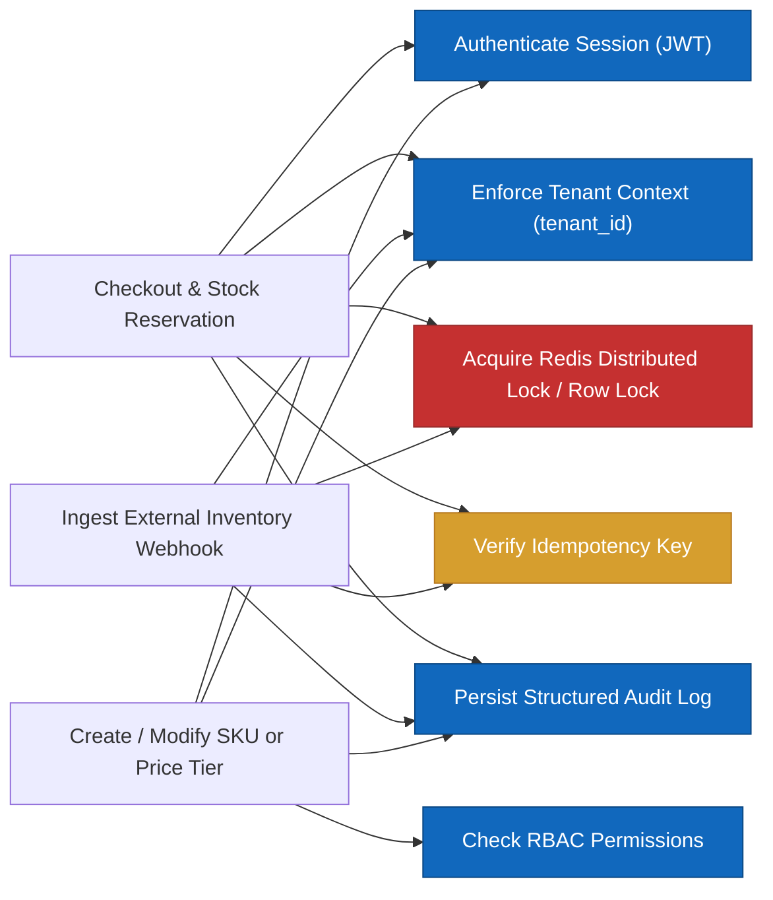
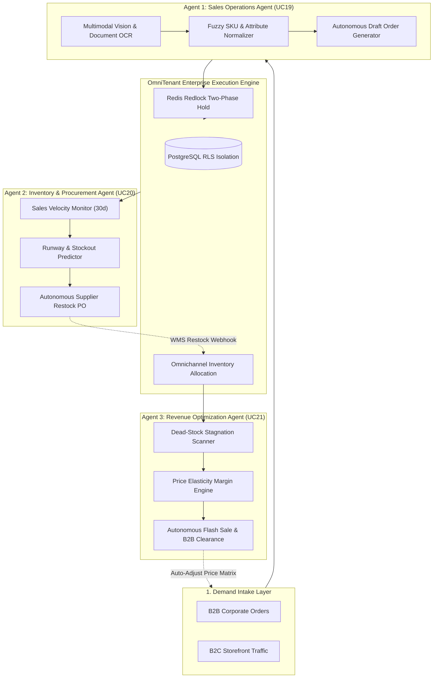

# Actors, roles, use cases — OmniTenant V1

> Design status: TARGET V1
>
> Current implementation: Architecture Blueprint & API Contracts

Product name: **OmniTenant**.

## Actors / roles

| Role | Code | Display name in UI | Scope & Description |
|---|---|---|---|
| `PLATFORM_SUPERADMIN` | `superadmin` | Platform SuperAdmin | Global platform root administrator. Manages tenant lifecycle provisioning, platform subscriptions, global quotas, and cross-tenant security audit logs. |
| `TENANT_OWNER` | `tenant_admin` | Tenant Owner | Tenant administrator. Manages organization branding, custom domains, staff accounts, role-based access control (RBAC), price tiers, webhook configurations, and analytics. |
| `WAREHOUSE_OPERATOR` | `warehouse_ops` | Warehouse Operator | Inventory & warehouse fulfillment operator. Manages product catalog, SKUs, safety stock levels, multi-channel inventory allocations, and resolves sync divergence. |
| `B2B_BUYER` | `b2b_buyer` | B2B Buyer | Authenticated corporate wholesale customer. Accesses volume-based tiered pricing, credit limits, purchase order checkouts, and bulk CSV order uploads. |
| `B2C_SHOPPER` | `b2c_shopper` | B2C Shopper | Retail customer. Browses public merchant storefronts, executes real-time concurrent checkouts, tracks orders, and accesses invoices. |

---

## Role × feature matrix

| Feature | Platform SuperAdmin | Tenant Owner | Warehouse Operator | B2B Buyer | B2C Shopper |
|---|---|---|---|---|---|
| **Global Tenant Provisioning & Lifecycle** | ✓ | | | | |
| **Global Subscriptions & Resource Quotas** | ✓ | | | | |
| **Platform-Wide Audit & Security Logs** | ✓ | | | | |
| **Tenant Authentication & Context Switching** | View all | ✓ | ✓ | | |
| **Tenant User Management & RBAC** | | ✓ | | | |
| **Storefront Customization & Domain Binding** | | ✓ | | | |
| **Webhook Endpoints & Secret Rotation** | | ✓ | | | |
| **Product Catalog & Variant Management** | Global view | ✓ | ✓ | | |
| **SKU Lifecycle & Barcode Tracking** | Global view | ✓ | ✓ | | |
| **Multi-Channel Inventory Allocation** | | ✓ | ✓ | | |
| **Safety Stock Thresholds & Alerts** | | ✓ | ✓ | | |
| **External Inventory Webhook Ingestion** | System | ✓ | ✓ | | |
| **Inventory Divergence & Conflict Resolution** | | ✓ | ✓ | | |
| **Tiered Volume Pricing & Price Lists** | | ✓ | | | |
| **Tenant Sales & Allocation Analytics** | Global | ✓ | Stock KPIs | | |
| **Browse Catalog & Dynamic Tier Pricing** | | ✓ | ✓ | Wholesale tier | Retail tier |
| **High-Concurrency Stock Reservation & Cart** | | | | ✓ | ✓ |
| **Idempotent Checkout & Payment Settlement** | | | | PO / Credit | Card / Gateway |
| **B2B Bulk CSV Order Upload** | | | | ✓ | |
| **Order Status Tracking & Invoices** | View all | ✓ | ✓ | Own orders | Own orders |
| **Tenant Audit Activity Trail** | Global | ✓ | | | |
| **AI-Driven B2B PO Parsing (Snap-to-Order)** | | ✓ | | ✓ | |
| **Autonomous AI Inventory Copilot & Forecasting** | | ✓ | ✓ | | |
| **Autonomous AI Dead-Stock Markdown Agent** | | ✓ | | | |

Unauthorized endpoint or UI route access returns `403 Forbidden` with standardized `ProblemDetails` payloads.

---

## Use Case Diagram

```mermaid
flowchart LR
    subgraph leftActors["Platform & Tenant Management"]
        direction TB
        superAdmin(["Platform SuperAdmin"])
        tenantAdmin(["Tenant Owner"])
    end

    subgraph system["OmniTenant — System Boundary"]
        direction TB

        subgraph platform["Platform Governance"]
            direction LR
            uc01["UC01 Global Login"]
            uc02["UC02 Provision Tenant"]
            uc03["UC03 Manage Global Subscriptions"]
            uc04["UC04 Audit Platform Logs"]
        end

        subgraph tenantGov["Tenant Administration & Config"]
            direction LR
            uc05["UC05 Tenant Login & Switch"]
            uc06["UC06 Manage Tenant Users & RBAC"]
            uc07["UC07 Configure Storefront & Webhooks"]
            uc08["UC08 View Aggregated Analytics"]
            uc09["UC09 Manage Price Tiers"]
        end

        subgraph inventoryOps["Catalog & Omnichannel Inventory"]
            direction LR
            uc10["UC10 Manage Catalog & SKUs"]
            uc11["UC11 Adjust Safety Stock"]
            uc12["UC12 Allocate Channel Inventory"]
            uc13["UC13 Ingest Inventory Webhook"]
            uc14["UC14 Resolve Sync Conflicts"]
        end

        subgraph commerceFlow["Commerce, Checkout & Fulfillment"]
            direction LR
            uc15["UC15 Browse Catalog & Prices"]
            uc16["UC16 Reserve Stock & Checkout"]
            uc17["UC17 Track Order & Invoices"]
            uc18["UC18 Bulk Order Upload (B2B)"]
        end
    end

    subgraph rightActors["Operations & Shoppers"]
        direction TB
        inventoryMgr(["Warehouse Operator"])
        b2bBuyer(["B2B Buyer"])
        b2cCustomer(["B2C Shopper"])
    end

    superAdmin --> uc01 & uc02 & uc03 & uc04
    tenantAdmin --> uc05 & uc06 & uc07 & uc08 & uc09 & uc10 & uc11 & uc12 & uc13 & uc14 & uc17
    inventoryMgr --> uc05 & uc10 & uc11 & uc12 & uc13 & uc14 & uc17
    b2bBuyer --> uc15 & uc16 & uc17 & uc18
    b2cCustomer --> uc15 & uc16 & uc17

    classDef actor fill:#4a5568,color:#fff,stroke:#2d3748
    classDef platformStyle fill:#1a365d,color:#fff,stroke:#0f2744
    classDef tenantStyle fill:#1168bd,color:#fff,stroke:#0b4f9e
    classDef inventoryStyle fill:#2b6cb0,color:#fff,stroke:#1a4971
    classDef commerceStyle fill:#3182ce,color:#fff,stroke:#2b6cb0

    class superAdmin,tenantAdmin,inventoryMgr,b2bBuyer,b2cCustomer actor
    class uc01,uc02,uc03,uc04 platformStyle
    class uc05,uc06,uc07,uc08,uc09 tenantStyle
    class uc10,uc11,uc12,uc13,uc14 inventoryStyle
    class uc15,uc16,uc17,uc18 commerceStyle

    style leftActors fill:#ffffff,stroke:#cbd5e0,stroke-dasharray:5 5
    style rightActors fill:#ffffff,stroke:#cbd5e0,stroke-dasharray:5 5
    style system fill:#f8fbff,stroke:#1168bd,stroke-dasharray:5 5
```

---

### Shared rules and constraints

1. **Row-Level Tenant Isolation**: All queries executed on behalf of a tenant must inject and validate `tenant_id`. Cross-tenant data leakage is prevented via automated query filters and isolated database connection schemas.
2. **Atomic Inventory Reservation**: Concurrency control prevents overselling during flash-sales or peak wholesale checkouts. Reservations leverage Redis distributed locks with a short lease (e.g. 5 minutes TTL) and transactional row updates.
3. **Idempotency Enforcement**: Mutating endpoints (such as `/api/v1/orders/checkout` and `/api/v1/webhooks/inventory`) mandate an `Idempotency-Key` header to protect against network retries and duplicate transactions.
4. **Immutable Audit Trail**: Administrative actions, configuration overrides, price modifications, and inventory stock adjustments are written to an append-only audit ledger with correlation IDs.

---

## Use cases

### UC01 Global Login

- **Actor:** `PLATFORM_SUPERADMIN`
- **Preconditions:** Active platform root administrator credentials with Multi-Factor Authentication (MFA) enabled.
- **Main flow:** Enter root email and password → complete MFA verification code → backend verifies platform-level authority → issue high-privilege Platform JWT (scope `platform:admin`) → redirect to Platform SuperAdmin Dashboard.
- **Alternative flow:** Invalid credentials or invalid MFA token returns `401 Unauthorized` and increments rate-limiting counters.
- **Permission:** `platform:superadmin`
- **Result:** Authenticated platform administrative session capable of provisioning and inspecting cross-tenant resources.

### UC02 Provision Tenant

- **Actor:** `PLATFORM_SUPERADMIN`
- **Preconditions:** Global administrator session is active.
- **Main flow:** Provide tenant organization name, slug, domain alias, subscription plan tier, and primary owner email → system allocates isolated tenant record → generates database schema/search index namespaces → creates default Tenant Owner credentials → dispatches tenant activation email with verification token.
- **Alternative flow:** Slug collision or domain conflict returns `409 Conflict`.
- **Permission:** `tenant:provision`
- **Result:** Fully provisioned, isolated tenant environment ready for storefront configuration and catalog setup.

### UC03 Manage Global Subscriptions

- **Actor:** `PLATFORM_SUPERADMIN`
- **Preconditions:** Global administrator session is active.
- **Main flow:** Select tenant organization → inspect current resource consumption (SKU count, API request rate, storage quota) → modify subscription tier or override custom quota limits → system commits updated quota bounds and emits `SubscriptionTierUpdated` domain event.
- **Permission:** `platform:subscriptions`
- **Result:** Tenant quota limits are enforced at the API gateway and application service boundaries.

### UC04 Audit Platform Logs

- **Actor:** `PLATFORM_SUPERADMIN`
- **Preconditions:** Global administrator session is active.
- **Main flow:** Filter cross-tenant audit ledger by tenant ID, actor identity, action type, date range, or IP address → display immutable security log events with redacted sensitive metadata → optionally export audit records as signed JSON/CSV.
- **Permission:** `platform:audit`
- **Result:** Transparent, legally defensible audit trail of all platform-level operations.

### UC05 Tenant Login & Switch

- **Actor:** `TENANT_OWNER`, `WAREHOUSE_OPERATOR`
- **Preconditions:** Active tenant staff account assigned to one or more tenants.
- **Main flow:** Enter email and password under tenant subdomain or main portal → system resolves user identity and tenant memberships → issue tenant-scoped JWT containing `tenant_id`, `user_id`, and assigned role claims (`role=TENANT_OWNER` or `role=WAREHOUSE_OPERATOR`) → if user belongs to multiple organizations, present tenant switcher modal to exchange JWT for chosen `tenant_id` context.
- **Alternative flow:** Inactive account or unverified tenant returns `403 Forbidden`.
- **Permission:** Public / Authenticated Staff
- **Result:** Client session securely pinned to the target tenant context.

### UC06 Manage Tenant Users & RBAC

- **Actor:** `TENANT_OWNER`
- **Preconditions:** Tenant administrator session is active.
- **Main flow:** List organization users → invite new team member by email → assign specific role (`TENANT_OWNER`, `WAREHOUSE_OPERATOR`, `STAFF_VIEWER`) → system dispatches invitation link → owner can revoke access, toggle active status, or update role assignments at any time.
- **Permission:** `tenant:users:manage`
- **Result:** Staff permissions strictly enforced at the API controller layer.

### UC07 Configure Storefront & Webhooks

- **Actor:** `TENANT_OWNER`
- **Preconditions:** Tenant administrator session is active.
- **Main flow:** Configure custom domain (CNAME verification), brand logo, primary colors, support email, and currency formatting → register outbound webhook destination URLs (e.g., `OrderPlaced`, `InventoryDepleted`) along with an HMAC SHA-256 signing secret → test webhook endpoint with mock ping payload.
- **Permission:** `tenant:settings:manage`
- **Result:** Storefront styling and reliable event dispatch integrations configured.

### UC08 View Aggregated Analytics

- **Actor:** `TENANT_OWNER`, `WAREHOUSE_OPERATOR` (Stock KPIs only)
- **Preconditions:** Authenticated staff session is active.
- **Main flow:** Select date range and sales channel (All, B2C Online, B2B Wholesale) → system computes aggregated revenue, gross margin, top-selling SKUs, conversion rate, out-of-stock frequency, and channel inventory distribution → render interactive charts and summary cards.
- **Permission:** `tenant:analytics:read`
- **Result:** Real-time visibility into business performance and stock health.

### UC09 Manage Price Tiers

- **Actor:** `TENANT_OWNER`
- **Preconditions:** Catalog items and B2B customer groups exist.
- **Main flow:** Define pricing tiers (Retail MSRP, Wholesale Tier 1, Wholesale Tier 2) → configure minimum order quantity (MOQ) thresholds and volume discount tiers per SKU or category → link customer accounts or corporate tiers to specific price rules → save price catalog.
- **Permission:** `pricing:manage`
- **Result:** Automated price calculation applied dynamically during catalog browsing and checkout.

### UC10 Manage Catalog & SKUs

- **Actor:** `TENANT_OWNER`, `WAREHOUSE_OPERATOR`
- **Preconditions:** Authenticated tenant staff session.
- **Main flow:** Create product master → specify title, description, category, and base attributes (size, color, material) → generate child SKU variants with individual barcodes, weights, and initial cost/price → upload product gallery images → publish or archive catalog items.
- **Permission:** `catalog:manage`
- **Result:** Centralized multi-variant catalog available for channel allocation and storefront display.

### UC11 Adjust Safety Stock

- **Actor:** `TENANT_OWNER`, `WAREHOUSE_OPERATOR`
- **Preconditions:** Active SKU records exist.
- **Main flow:** View SKU inventory dashboard → set minimum safety stock buffer thresholds per warehouse or channel → configure automated low-stock webhook notification triggers → commit threshold settings.
- **Alternative flow:** Setting safety buffer greater than total physical stock triggers a warning confirmation prompt.
- **Permission:** `inventory:manage`
- **Result:** Channels automatically mark items as "Out of Stock" or trigger reorder notifications when physical stock approaches safety buffer.

### UC12 Allocate Channel Inventory

- **Actor:** `TENANT_OWNER`, `WAREHOUSE_OPERATOR`
- **Preconditions:** Total warehouse physical stock is available.
- **Main flow:** Select SKU → view total unallocated physical stock → distribute inventory quotas across dedicated channels (e.g. 50% B2C Storefront, 40% B2B Wholesale, 10% Reserve Buffer) → system atomically updates channel allocation records and publishes inventory synchronization events.
- **Alternative flow:** Sum of channel allocations exceeds total unallocated stock → system rejects transaction with `422 Unprocessable Entity`.
- **Permission:** `inventory:allocate`
- **Result:** Channel-specific availability synchronized across all digital sales touchpoints.

### UC13 Ingest Inventory Webhook

- **Actor:** External Warehouse / ERP System (Machine-to-Machine)
- **Preconditions:** External system possesses valid tenant webhook API key and HMAC secret.
- **Main flow:** External WMS sends HTTP POST payload containing SKU barcode, warehouse ID, quantity delta (e.g. restock or physical shrinkage), and batch sequence ID → OmniTenant gateway verifies HMAC signature and `Idempotency-Key` → acquires distributed lock for the target SKU → updates physical stock level → adjusts channel allocations accordingly → persists ingestion audit log and responds `200 OK`.
- **Alternative flow:** Invalid HMAC signature returns `401 Unauthorized`; duplicate idempotency key returns cached previous response without re-processing.
- **Permission:** Webhook HMAC authentication
- **Result:** Real-time stock levels synchronized with external warehouse operations.

### UC14 Resolve Sync Conflicts

- **Actor:** `TENANT_OWNER`, `WAREHOUSE_OPERATOR`
- **Preconditions:** Discrepancy flagged between physical warehouse report and digital channel records.
- **Main flow:** Review conflict queue showing timestamp, external reported delta, current system allocation, and divergence cause → select resolution strategy (Force System Overwrite, Accept Physical Count, or Re-audit) → system applies rebalancing delta and records reconciliation note.
- **Permission:** `inventory:reconcile`
- **Result:** Inventory state reconciled with full discrepancy audit logging.

### UC15 Browse Catalog & Prices

- **Actor:** `B2C_SHOPPER`, `B2B_BUYER`
- **Preconditions:** Storefront accessible via tenant domain or slug.
- **Main flow:** Shopper searches or navigates category taxonomy → system retrieves active catalog items scoped to the current tenant → evaluates user identity context:
  - Unauthenticated / Retail Shopper: receives standard retail MSRP.
  - Authenticated B2B Buyer: receives personalized contract price and tiered volume break discounts.
- Stock availability indicator shows "In Stock", "Low Stock", or "Backorder" based on allocated channel inventory minus safety buffer.
- **Permission:** Public / Authenticated Buyer
- **Result:** Optimized, personalized product catalog presented with sub-second latency.

### UC16 Reserve Stock & Checkout

- **Actor:** `B2C_SHOPPER`, `B2B_BUYER`
- **Preconditions:** Cart contains valid active SKUs with positive quantities.
- **Main flow:**
  1. Customer submits checkout form with shipping address, billing details, and `Idempotency-Key`.
  2. System initiates Two-Phase Stock Reservation: acquires distributed Redis lock on target SKUs.
  3. Verifies available channel stock ≥ requested quantity.
  4. Decrements channel stock and creates temporary reservation hold (TTL: 15 minutes).
  5. Releases Redis lock.
  6. Directs customer to payment processing (Credit card gateway for B2C; Credit Line / Purchase Order term for B2B).
  7. Upon payment authorization, converts stock reservation to confirmed `OrderPlaced` state.
- **Alternative flow:** Insufficient stock on any item immediately returns `409 Conflict` (naming specific unavailable SKUs) without reserving partial stock. Payment failure releases reservation hold back to available channel pool.
- **Permission:** Public / Authenticated
- **Result:** Zero overselling guaranteed; order confirmed and persisted with unique order reference.

### UC17 Track Order & Invoices

- **Actor:** `B2C_SHOPPER`, `B2B_BUYER`, `TENANT_OWNER`, `WAREHOUSE_OPERATOR`
- **Preconditions:** Valid order ID and authorization token / guest lookup token.
- **Main flow:** Inspect order timeline (Payment Authorized → Allocation Confirmed → Packing → Dispatched → Delivered) → view itemized line-items, tax breakdown, and shipping details → download digitally generated PDF invoice.
- **Permission:** `orders:read` (scoped to `tenant_id` and buyer ownership)
- **Result:** Full order transparency for customers and fulfillment operators.

### UC18 Bulk Order Upload (B2B)

- **Actor:** `B2B_BUYER`
- **Preconditions:** Authenticated corporate buyer account with wholesale permissions.
- **Main flow:** Upload CSV or Excel file containing order lines (`SKU_Code`, `Quantity`, `Custom_Reference`) → system parses file, validates SKU existence, enforces MOQ constraints, checks real-time channel stock availability, and applies tiered volume pricing → displays validation preview table showing line status and calculated line totals → buyer confirms bulk order creation → system atomically reserves stock and generates pending wholesale order.
- **Alternative flow:** File syntax error or unresolvable SKUs produces detailed validation report identifying offending rows; valid rows are previewed for partial approval or all-or-nothing correction.
- **Permission:** `b2b:bulk_order`
- **Result:** High-volume wholesale orders placed efficiently without manual line-by-line cart entry.

### UC19 AI-Driven B2B Purchase Order Parsing (Snap-to-Order)

- **Actor:** `B2B_BUYER`, `TENANT_OWNER`
- **Preconditions:** Authenticated tenant account; digital image (PNG/JPEG) or PDF of handwritten order, paper invoice, or raw text message.
- **Main flow:**
  1. User uploads document/image or pastes unstructured purchase order text.
  2. System dispatches file to Multimodal Vision + LLM pipeline via background ingestion worker.
  3. AI extracts line-item entities (product name, attributes, requested quantity, supplier notes).
  4. System executes scoped semantic/fuzzy match against tenant's product catalog (PostgreSQL trigram / pgvector), resolving noisy human text to exact `sku_id`s.
  5. Evaluates real-time channel stock availability and automatically calculates B2B volume tier discounts.
  6. Returns structured Draft Order preview with per-line confidence scores ($0.0 - 1.0$), highlighting ambiguous or low-confidence matches for single-click user confirmation.
  7. User reviews and clicks "Confirm Order" to atomically create an official wholesale order.
- **Alternative flow:** If an extracted product has zero match confidence or ambiguous variants (e.g. multiple sizes match), system flags line item as `ATTENTION_REQUIRED` and provides an autocomplete dropdown for manual selection.
- **Permission:** `b2b:ai_order`
- **Result:** Drastically reduces B2B order entry time from 15 minutes to 3 seconds, eliminating manual data entry bottlenecks.

### UC20 Autonomous AI Inventory Copilot & Forecasting

- **Actor:** `TENANT_OWNER`, `WAREHOUSE_OPERATOR`
- **Preconditions:** Historical sales transactions and active channel inventory allocations.
- **Main flow:**
  1. Scheduled AI Analytics Worker analyzes 30-day rolling sales velocity, seasonality, and consumption rates across all sales channels.
  2. Computes "Runway Days" (estimated days until stockout) for each SKU: $\text{Runway} = \frac{\text{AvailableStock}}{\text{DailyBurnRate}}$.
  3. Detects high-risk SKUs where Runway $\le$ Supplier Lead Time + Safety Buffer.
  4. Generates an autonomous replenishment recommendation (Suggested Reorder Quantity, Estimated Restock Cost, Supplier Info).
  5. Posts real-time alert to Warehouse Dashboard and dispatches notification to operators.
  6. Operator clicks "Approve Recommendation" to automatically generate a Purchase Order (PO) and push stock update expectation to WMS via webhook.
- **Alternative flow:** If historical data is insufficient (< 7 days), system falls back to configured static safety thresholds with an informative banner.
- **Permission:** `inventory:forecast`
- **Result:** Proactive stockout prevention and autonomous replenishment workflow eliminating human calculation errors.

### UC21 Autonomous Dead-Stock Liquidation & Dynamic Markdown

- **Actor:** `TENANT_OWNER`
- **Preconditions:** Active product SKUs with inventory age $\ge 30$ days and a $>50\%$ deceleration in 14-day sales velocity.
- **Main flow:**
  1. Revenue Optimization AI Agent executes daily inventory stagnation scan across all channels.
  2. Identifies "Dead Stock" SKUs tying up warehouse capital:
     $$\text{StagnationScore} = \text{DaysInInventory} \times \left(1 - \frac{\text{RecentVelocity}}{\text{HistoricalAverageVelocity}}\right)$$
  3. Computes optimal price elasticity discount rate (15% to 35%) to stimulate demand while protecting gross margin floor.
  4. Generates an automated Liquidation Campaign Proposal:
     - Flash Sale schedule (e.g. 48-hour storefront markdown banner).
     - B2B Bulk Clearance Tier (special volume break for corporate buyers).
  5. Tenant Owner receives alert in Admin Dashboard and clicks "Activate Campaign".
  6. System atomically updates channel price matrices and schedules an automatic price rollback upon campaign expiration.
- **Alternative flow:** If product cost floor would be breached by proposed discount, system caps markdown at minimum margin preservation threshold and flags for human manual review.
- **Permission:** `pricing:ai_markdown`
- **Result:** Automated capital recovery from slow-moving inventory without manual spreadsheet analysis.

---

## Autonomous Tri-Agent Closed-Loop Architecture

The 3 AI Agents work in a self-reinforcing, closed-loop cycle across the enterprise commerce lifecycle:

