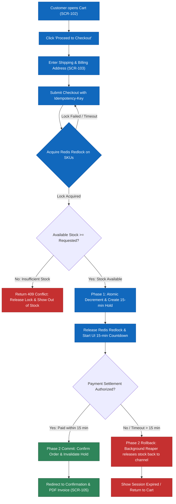
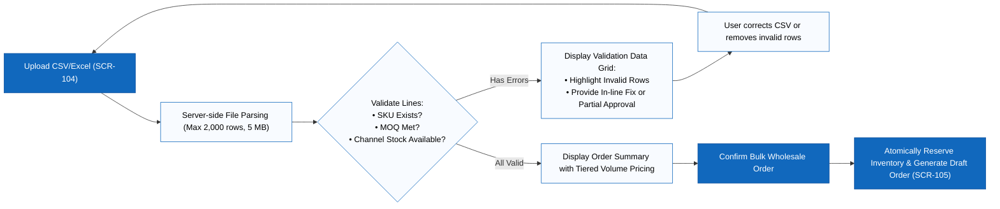
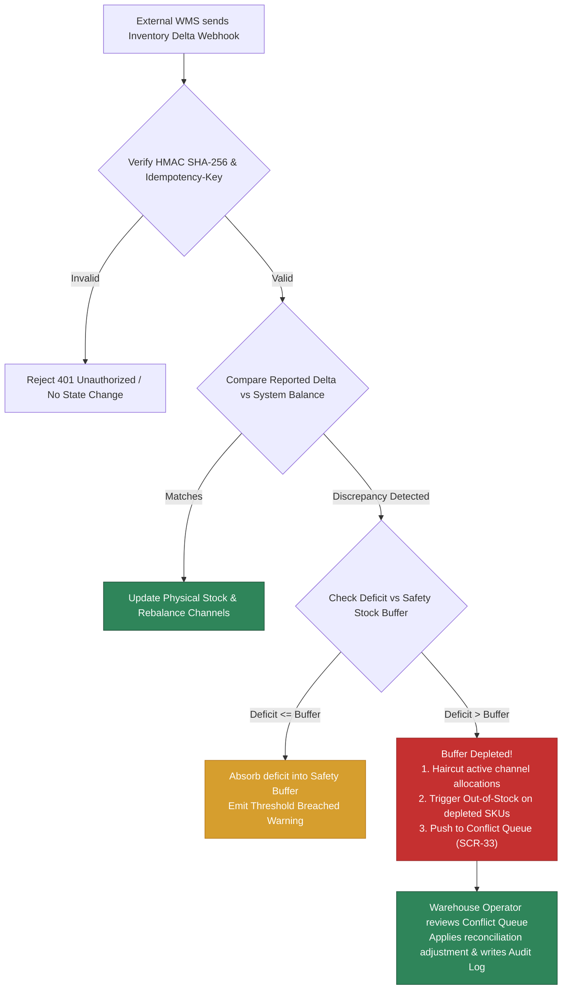

# Information Architecture & Screen Hierarchy — OmniTenant V1

> Design status: TARGET V1
>
> Current implementation: Architecture Blueprint & API Contracts

Product name: **OmniTenant**.

---

## 1. Routing Architecture & Sitemap

OmniTenant is structured into two dedicated frontends sharing a unified backend engine: the **Tenant Admin Backoffice** (for administrative and fulfillment operations) and the **Customer Storefront** (for retail and wholesale commerce).


```text
OmniTenant Platform
│
├── Platform & Authentication (Root Shell)
│   ├── /login                     (Universal sign-in with tenant context resolver)
│   ├── /switch-tenant             (Organization switcher for multi-tenant users)
│   └── /403                       (Forbidden error display with return routes)
│
├── Tenant Admin Backoffice (/admin)
│   ├── Dashboard (/admin/dashboard)
│   │   ├── Real-time sales & gross revenue KPIs
│   │   ├── Channel allocation breakdown widget
│   │   ├── Safety stock threshold breach alerts
│   │   └── Recent sync conflicts & reconciliation widget
│   │
│   ├── Catalog Management (/admin/catalog)
│   │   ├── Product & variant data grid (filters, search, pagination)
│   │   ├── Create / Edit Product Modal (attributes, option groups)
│   │   ├── SKU Variant Manager Drawer (barcodes, weights, cost)
│   │   └── Product Media Gallery Uploader
│   │
│   ├── Inventory Allocation Hub (/admin/inventory)
│   │   ├── Multi-channel stock allocation matrix (Online, Wholesale, Retail)
│   │   ├── Safety Stock Configuration Modal (thresholds & alerts)
│   │   ├── Manual Stock Rebalance Modal
│   │   └── Sync Conflict Reconciliation Queue (/admin/inventory/conflicts)
│   │
│   ├── Pricing & Wholesale Tiers (/admin/pricing)
│   │   ├── Tiered Volume Pricing Grid (MSRP, Tier 1, Tier 2)
│   │   ├── Create / Edit Price Tier Modal (MOQ, percentage / fixed discount)
│   │   └── Customer Group Assignment Drawer
│   │
│   ├── Order Fulfillment Hub (/admin/orders)
│   │   ├── Order master-detail grid (status tabs, channel filters)
│   │   ├── Order Detail Drawer (items, timeline, shipping address)
│   │   ├── B2B Credit Limit Approval Modal (over-limit authorization)
│   │   └── Tax Invoice Generator & PDF Export Action
│   │
│   ├── Storefront & Webhook Configuration (/admin/settings)
│   │   ├── Branding & Custom Domain CNAME binding
│   │   ├── Webhook Endpoints Manager (URL registration, HMAC secret rotation)
│   │   └── Webhook Delivery Test & Event Ping Tool
│   │
│   ├── Staff & RBAC Management (/admin/users)
│   │   ├── Staff directory with active/inactive status toggle
│   │   ├── Invite Staff Modal (email, role assignment)
│   │   └── Role Permissions Matrix Viewer
│   │
│   └── System Audit Trail (/admin/audit)
│       └── Immutable security & mutation log viewer (actor, action, diff, IP)
│
└── Customer Storefront (/{tenant-slug})
    ├── Storefront Home (/{tenant-slug})
    ├── Catalog Browse (/{tenant-slug}/products)
    │   ├── Multi-attribute faceted filters (category, color, size, price)
    │   ├── Dynamic price cards (retail MSRP or B2B tiered wholesale pricing)
    │   └── Real-time stock availability badge (In Stock, Low Stock, Backorder)
    │
    ├── Product Detail Page (/{tenant-slug}/products/:sku)
    │   ├── Image gallery & variant picker
    │   ├── Tiered Volume Pricing breakdown table
    │   └── Add-to-Cart Action Bar with quantity selector
    │
    ├── Shopping Cart (/{tenant-slug}/cart)
    │   ├── Real-time stock validation check
    │   ├── Order summary & volume discount calculations
    │   └── Proceed to Checkout Action
    │
    ├── High-Concurrency Checkout (/{tenant-slug}/checkout)
    │   ├── Step 1: Customer identification & Tax/Shipping address
    │   ├── Step 2: Two-Phase Stock Reservation Hold notice (15-min countdown)
    │   ├── Step 3: Payment settlement (Credit Card / B2B Purchase Order terms)
    │   └── Step 4: Order Confirmation & Receipt
    │
    ├── B2B Bulk Order Portal (/{tenant-slug}/b2b/bulk-order)
    │   ├── CSV / Excel template download & drag-and-drop uploader
    │   ├── Line-item validation preview table (SKU matching, MOQ, pricing)
    │   └── One-click batch reservation & draft order submission
    │
    └── Order Tracking & Invoices (/{tenant-slug}/orders/:id)
        ├── Real-time order progress stepper
        └── Official PDF Invoice download
```

---

## 2. Page Permissions Matrix

Navigation menus, action buttons, and URLs are strictly enforced against user identity and permissions. Unauthorized route transitions redirect immediately to `#/403`.

| Screen / Area | Platform SuperAdmin | Tenant Owner | Warehouse Operator | B2B Buyer | B2C Shopper |
|---|---|---|---|---|---|
| **Global Login & Switcher** | ✓ | ✓ | ✓ | | |
| **Admin Dashboard** | Global view | ✓ | Stock KPIs only | | |
| **Catalog Management** | View all | ✓ | ✓ | | |
| **Inventory Allocation & Reconciliation** | | ✓ | ✓ | | |
| **Pricing & B2B Tiers** | | ✓ | | | |
| **Order Fulfillment** | View all | ✓ | ✓ | | |
| **Storefront Settings & Webhooks** | | ✓ | | | |
| **Staff & RBAC Management** | | ✓ | | | |
| **Audit Logs** | Global audit | Tenant audit | | | |
| **Storefront Catalog Browse** | | ✓ | ✓ | Tiered wholesale | Retail MSRP |
| **Product Detail & Stock Badge** | | ✓ | ✓ | Tiered pricing | Retail pricing |
| **Shopping Cart** | | | | ✓ | ✓ |
| **Checkout & Stock Reservation** | | | | Purchase Order / Credit | Credit card / Gateway |
| **B2B Bulk CSV Upload** | | | | ✓ | |
| **Order Tracking & Invoice PDF** | View all | ✓ | ✓ | Own orders | Own orders |

---

## 3. Screen Inventory

| Screen ID | Screen Name | Presentation | Related Stories | Target Design Status |
|---|---|---|---|---|
| `SCR-01` | Universal Sign-In | Full page | US01, US02 | Target V1 Specification |
| `SCR-02` | Organization Switcher | Modal on Sign-In | US02 | Target V1 Specification |
| `SCR-03` | Forbidden Display | Full page | Cross-cutting RBAC | Target V1 Specification |
| `SCR-10` | Backoffice Dashboard | Full page | US08, US16 | Target V1 Specification |
| `SCR-20` | Catalog Data Grid | Full page | US04, US05 | Target V1 Specification |
| `SCR-21` | Product Master Create/Edit | Modal on Catalog | US04 | Target V1 Specification |
| `SCR-22` | SKU Variant Drawer | Drawer on Catalog | US04, US06 | Target V1 Specification |
| `SCR-30` | Inventory Allocation Hub | Full page | US07, US09 | Target V1 Specification |
| `SCR-31` | Safety Stock Configuration | Modal on Inventory | US09 | Target V1 Specification |
| `SCR-32` | Manual Stock Rebalance | Modal on Inventory | US07 | Target V1 Specification |
| `SCR-33` | Sync Conflict Reconciliation Queue | Full page | US15, US14 | Target V1 Specification |
| `SCR-40` | Price Tier Manager | Full page | US11 | Target V1 Specification |
| `SCR-41` | Price Tier Form | Modal on Pricing | US11 | Target V1 Specification |
| `SCR-50` | Order Fulfillment Grid | Full page | US14, US10 | Target V1 Specification |
| `SCR-51` | Order Detail & Timeline | Drawer on Orders | US14, US16 | Target V1 Specification |
| `SCR-52` | B2B Credit Limit Over-Limit Approval | Modal on Orders | US10 | Target V1 Specification |
| `SCR-60` | Storefront Branding & Settings | Full page | US18 | Target V1 Specification |
| `SCR-61` | Webhook Endpoint Manager | Tab on Settings | US15, US18 | Target V1 Specification |
| `SCR-70` | Staff & RBAC Directory | Full page | US17 | Target V1 Specification |
| `SCR-71` | Invite Staff Member | Modal on Users | US17 | Target V1 Specification |
| `SCR-80` | Tenant Audit Log Viewer | Full page | US16 | Target V1 Specification |
| `SCR-100` | Storefront Catalog Browse | Full page | US05, US13 | Target V1 Specification |
| `SCR-101` | Product Detail & Tier Matrix | Full page | US05, US11 | Target V1 Specification |
| `SCR-102` | Shopping Cart Drawer / Page | Drawer / Page | US13 | Target V1 Specification |
| `SCR-103` | Multi-Step Checkout & Hold Notice | Full page | US08, US14 | Target V1 Specification |
| `SCR-104` | B2B Bulk Order Upload Portal | Full page | US11, US12 | Target V1 Specification |
| `SCR-105` | Customer Order Tracking & PDF Invoice | Full page | US14 | Target V1 Specification |

---

## 4. Requirement-to-Screen Mapping

| User Story | Primary Screen / Interface Trigger | Core Action & Transition |
|---|---|---|
| **US01** | `SCR-01` Universal Sign-In | Submit root email, password & TOTP code $\rightarrow$ Redirect to Global Dashboard. |
| **US02** | `SCR-01` & `SCR-02` Organization Switcher | Authenticate tenant staff credentials $\rightarrow$ Select active `tenant_id` context. |
| **US03** | Backoffice Tenant Provisioning API | Submitting tenant registration seeds DB schema and emits activation email. |
| **US04** | `SCR-20`, `SCR-21`, `SCR-22` Catalog & Variants | Create product parent $\rightarrow$ Configure option groups $\rightarrow$ Generate child SKUs. |
| **US05** | `SCR-100` Storefront Catalog | Apply category hierarchy, faceted attribute filters, and search queries. |
| **US06** | `SCR-22` Variant Drawer | Assign unique barcodes (EAN/UPC), dimensions, weights, and cost metrics. |
| **US07** | `SCR-30`, `SCR-32` Inventory Allocation | Distribute physical warehouse stock across channels; enforce $\sum \text{allocated} \le \text{total}$. |
| **US08** | `SCR-103` Checkout Flow | Step 2 acquires distributed Redis lock, decrements channel stock, starts 15-min TTL hold. |
| **US09** | `SCR-31` Safety Stock Configuration | Set safety buffer threshold; triggers `InventoryThresholdBreached` when breached. |
| **US10** | `SCR-50`, `SCR-52` Credit Limit Approval | Inspect B2B buyer available credit; approve over-limit order with reason note. |
| **US11** | `SCR-40`, `SCR-41`, `SCR-101` Price Tiers | Define volume thresholds; storefront dynamically resolves tier unit price. |
| **US12** | `SCR-104` B2B Bulk Order Upload | Upload `.csv`/`.xlsx` $\rightarrow$ Validate rows $\rightarrow$ Preview discrepancies $\rightarrow$ Confirm batch order. |
| **US13** | `SCR-100`, `SCR-102` Storefront Cart | Modify line items with sub-10ms response time; display live channel stock badge. |
| **US14** | `SCR-103`, `SCR-105` Checkout & Invoices | Submit checkout with `Idempotency-Key` $\rightarrow$ Settle payment $\rightarrow$ Render PDF invoice. |
| **US15** | `SCR-33`, `SCR-61` Webhook Ingestion | Ingest external WMS deltas; verify HMAC SHA-256 signature; route conflicts to queue. |
| **US16** | `SCR-80` Audit Log Viewer | Filter immutable event stream by actor, tenant, action, and correlation ID. |
| **US17** | `SCR-70`, `SCR-71` Staff Directory | Invite staff members; assign `TENANT_OWNER` or `WAREHOUSE_OPERATOR` role. |
| **US18** | `SCR-60`, `SCR-61` Storefront Settings | Configure brand assets, custom domain CNAME, and outbound webhook endpoints. |

---

## 5. Screen Hierarchy Diagram

```mermaid
flowchart TB
    Root["OmniTenant Platform"]
    Login["SCR-01 Sign-In"]
    Switcher["SCR-02 Tenant Switcher Modal"]
    Forbidden["SCR-03 403 Forbidden"]

    Root --> Login
    Login --> Switcher
    Login --> Forbidden

    %% Backoffice
    BackofficeShell["Admin Backoffice Shell (/admin)"]
    Switcher --> BackofficeShell

    Dashboard["SCR-10 Dashboard"]
    Catalog["SCR-20 Catalog Grid"]
    ProdModal["SCR-21 Create/Edit Product"]
    VariantDrawer["SCR-22 SKU Variant Drawer"]
    Inventory["SCR-30 Inventory Allocation"]
    SafetyModal["SCR-31 Safety Stock Config"]
    RebalanceModal["SCR-32 Stock Rebalance"]
    ConflictQueue["SCR-33 Sync Conflict Queue"]
    Pricing["SCR-40 Price Tiers"]
    PriceModal["SCR-41 Tier Form Modal"]
    Orders["SCR-50 Order Fulfillment"]
    OrderDetail["SCR-51 Order Detail Drawer"]
    CreditModal["SCR-52 B2B Credit Approval"]
    Settings["SCR-60 Settings & Branding"]
    WebhookTab["SCR-61 Webhook Manager"]
    Users["SCR-70 Staff Directory"]
    UserInvite["SCR-71 Invite Staff Modal"]
    Audit["SCR-80 Audit Logs"]

    BackofficeShell --> Dashboard
    BackofficeShell --> Catalog
    Catalog --> ProdModal
    Catalog --> VariantDrawer
    BackofficeShell --> Inventory
    Inventory --> SafetyModal
    Inventory --> RebalanceModal
    Inventory --> ConflictQueue
    BackofficeShell --> Pricing
    Pricing --> PriceModal
    BackofficeShell --> Orders
    Orders --> OrderDetail
    Orders --> CreditModal
    BackofficeShell --> Settings
    Settings --> WebhookTab
    BackofficeShell --> Users
    Users --> UserInvite
    BackofficeShell --> Audit

    %% Storefront
    StorefrontShell["Storefront Shell (/{tenant-slug})"]
    Root --> StorefrontShell

    Browse["SCR-100 Catalog Browse"]
    PDP["SCR-101 Product Detail & Tiers"]
    Cart["SCR-102 Shopping Cart"]
    Checkout["SCR-103 Checkout & 15m Hold"]
    BulkOrder["SCR-104 B2B Bulk Upload"]
    Tracking["SCR-105 Order Tracking & Invoice"]

    StorefrontShell --> Browse
    Browse --> PDP
    PDP --> Cart
    Cart --> Checkout
    Checkout --> Tracking
    StorefrontShell --> BulkOrder
    BulkOrder --> Checkout

    classDef shell fill:#1a365d,color:#fff,stroke:#0f2744
    classDef admin fill:#1168bd,color:#fff,stroke:#0b4f9e
    classDef store fill:#2b6cb0,color:#fff,stroke:#1a4971
    classDef sub fill:#f7fafc,color:#2d3748,stroke:#cbd5e0

    class Root,Login,Forbidden shell
    class BackofficeShell,Dashboard,Catalog,Inventory,Pricing,Orders,Settings,Users,Audit admin
    class StorefrontShell,Browse,PDP,Cart,Checkout,BulkOrder,Tracking store
    class Switcher,ProdModal,VariantDrawer,SafetyModal,RebalanceModal,ConflictQueue,PriceModal,OrderDetail,CreditModal,WebhookTab,UserInvite sub
```



---

## 6. Primary Task Flows

### Flow 1: High-Concurrency Checkout & Two-Phase Stock Reservation



### Flow 2: B2B Bulk Order Upload & Validation Flow



### Flow 3: Inventory Allocation & Sync Conflict Reconciliation



---

## 7. UI/UX State Contract

Every screen and component in OmniTenant conforms strictly to the following 9-state contract to guarantee predictable, accessible user experiences:

| State | Visual Presentation | Interaction Rules & Backend Contract |
|---|---|---|
| **1. Initial Loading** | Content skeletons mirroring the final card/table dimensions. | Navigation shell remains interactive; duplicate click triggers are suppressed. |
| **2. Empty Dataset** | Distinct illustrated states for "No data created yet" vs. "No records match active filters". | Displays clear Call-To-Action (e.g. "Add First SKU" or "Reset Filters"). |
| **3. Form Validation Error** | Red outline on invalid field; inline error text below field with `aria-describedby`. | Focus is automatically placed on the first invalid field; user input is preserved. |
| **4. API Error (ProblemDetails)** | Toast or inline banner displaying user-friendly message and clickable `Trace ID`. | Internal exception details are never exposed to clients; error mapped from RFC 7807 payload. |
| **5. Unauthorized (401)** | Immediate redirection to `/login` with `returnUrl` query parameter. | Client-side session tokens and user state are discarded. |
| **6. Forbidden (403)** | Render dedicated `SCR-03 Forbidden` view with safe return links. | Navigation menu items lacking permission are never rendered in the UI. |
| **7. Submitting / Processing** | Buttons enter loading spinner state; input controls are disabled. | Prevents double submission; enforces `Idempotency-Key` headers on mutating requests. |
| **8. Out of Stock / Depleted** | Prominent "Out of Stock" badge; primary CTA changed to disabled or "Join Waitlist". | Channel availability verified in real-time; prevents adding zero-inventory SKUs to cart. |
| **9. Reservation Hold Countdown** | Sticky 15-minute countdown progress bar on `SCR-103`. | Highlights remaining time to finalize payment; displays modal when reservation expires. |

---

## 8. Responsive & Accessibility Rules

1. **Responsive Viewport Support:**
   - **Desktop ($\ge 1024$px):** Full-column administrative tables with inline sorting, multi-select bulk actions, and side-by-side inspection drawers.
   - **Tablet ($768$px – $1023$px):** Collapsible sidebar navigation, priority column tables with horizontal scrolling, and sliding full-height drawers.
   - **Mobile ($< 768$px):** Transformed stacked card views for data grids, sticky bottom checkout action bars, and touch-optimized quantity steppers.

2. **Accessibility Standards (WCAG 2.1 AA):**
   - **Color Contrast:** All body text meets a minimum contrast ratio of 4.5:1 against backgrounds; badges meet 3:1.
   - **Keyboard Focus Management:** Modals trap keyboard focus (`Tab` / `Shift+Tab`) and close cleanly on `Escape` without triggering form submission.
   - **Screen Reader Support:** All icon buttons provide descriptive `aria-label` tags; live countdowns and stock status changes use `aria-live="polite"`.
   - **Explicit Formats:** Monetary amounts display ISO currency codes (e.g. `120.000 ₫` or `$150.00 USD`); dates format to ISO 8601 (`YYYY-MM-DD HH:mm UTC`).

---

## 9. Screen-to-API Operation Mapping

| Screen ID | Interface Name | Corresponding REST API Operations |
|---|---|---|
| `SCR-01` | Sign-In | `POST /api/v1/auth/login`, `POST /api/v1/auth/mfa/verify` |
| `SCR-02` | Tenant Switcher | `POST /api/v1/auth/switch-tenant`, `GET /api/v1/auth/user-tenants` |
| `SCR-10` | Dashboard | `GET /api/v1/analytics/dashboard-kpis`, `GET /api/v1/analytics/stock-health` |
| `SCR-20` | Catalog Grid | `GET /api/v1/products`, `DELETE /api/v1/products/{id}` |
| `SCR-21` | Product Form | `POST /api/v1/products`, `PUT /api/v1/products/{id}` |
| `SCR-22` | SKU Variant Drawer | `GET /api/v1/products/{id}/skus`, `POST /api/v1/products/{id}/skus`, `PUT /api/v1/skus/{sku}` |
| `SCR-30` | Inventory Allocation | `GET /api/v1/inventory/allocations`, `PUT /api/v1/inventory/allocations` |
| `SCR-31` | Safety Stock Modal | `PUT /api/v1/inventory/skus/{sku}/safety-stock` |
| `SCR-32` | Stock Rebalance | `POST /api/v1/inventory/rebalance` |
| `SCR-33` | Conflict Queue | `GET /api/v1/inventory/conflicts`, `POST /api/v1/inventory/conflicts/{id}/resolve` |
| `SCR-40` | Price Tier Grid | `GET /api/v1/pricing/tiers`, `DELETE /api/v1/pricing/tiers/{id}` |
| `SCR-41` | Price Tier Form | `POST /api/v1/pricing/tiers`, `PUT /api/v1/pricing/tiers/{id}` |
| `SCR-50` | Orders Grid | `GET /api/v1/orders`, `PUT /api/v1/orders/{id}/status` |
| `SCR-51` | Order Detail Drawer | `GET /api/v1/orders/{id}`, `GET /api/v1/orders/{id}/invoice.pdf` |
| `SCR-52` | Credit Limit Modal | `POST /api/v1/b2b/buyers/{id}/credit-approval` |
| `SCR-60` | Settings & Branding | `GET /api/v1/tenants/settings`, `PUT /api/v1/tenants/settings` |
| `SCR-61` | Webhook Manager | `GET /api/v1/webhooks`, `POST /api/v1/webhooks`, `POST /api/v1/webhooks/{id}/test` |
| `SCR-70` | Staff Directory | `GET /api/v1/users`, `PUT /api/v1/users/{id}/status` |
| `SCR-71` | Invite Staff Modal | `POST /api/v1/users/invite` |
| `SCR-80` | Audit Log Viewer | `GET /api/v1/audit-logs` |
| `SCR-100` | Storefront Catalog | `GET /api/v1/storefront/catalog`, `GET /api/v1/storefront/facets` |
| `SCR-101` | Product Detail (PDP) | `GET /api/v1/storefront/products/{sku}`, `GET /api/v1/storefront/pricing/{sku}` |
| `SCR-102` | Shopping Cart | `POST /api/v1/cart/items`, `PUT /api/v1/cart/items/{id}`, `GET /api/v1/cart` |
| `SCR-103` | Checkout Flow | `POST /api/v1/checkout/reserve`, `POST /api/v1/checkout/confirm` |
| `SCR-104` | B2B Bulk Upload | `POST /api/v1/b2b/bulk-orders/validate`, `POST /api/v1/b2b/bulk-orders/confirm` |
| `SCR-105` | Order Tracking | `GET /api/v1/storefront/orders/{id}`, `GET /api/v1/storefront/orders/{id}/invoice.pdf` |

---

**Related:** [Actors, roles, and use cases](03-use-cases.md) · [INVEST Requirements](08-invest-requirements.md) · [Acceptance criteria](06-acceptance-criteria.md)
