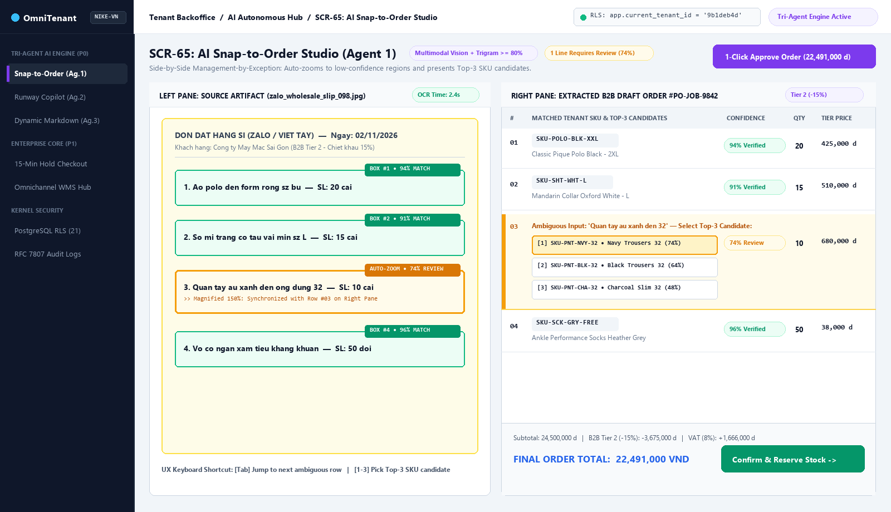
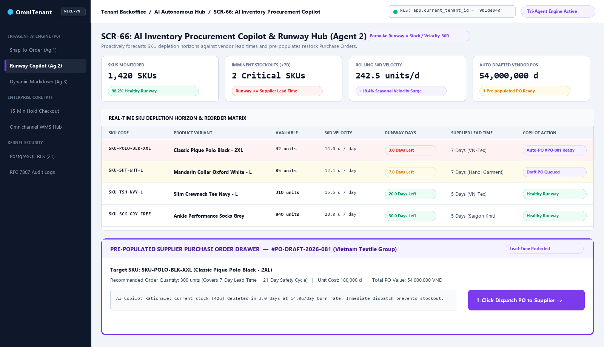
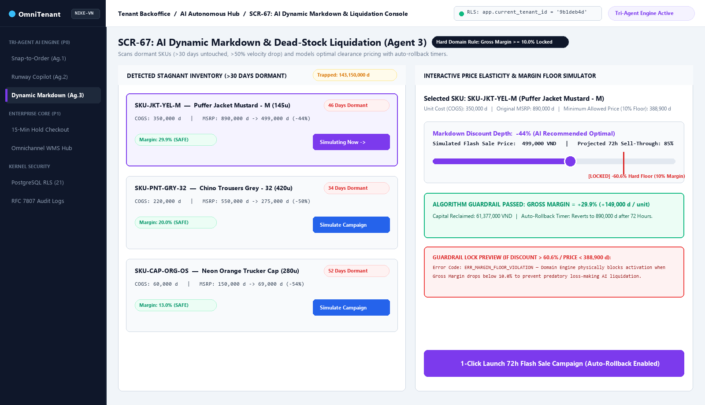
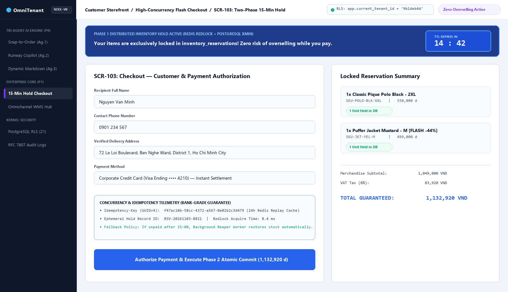
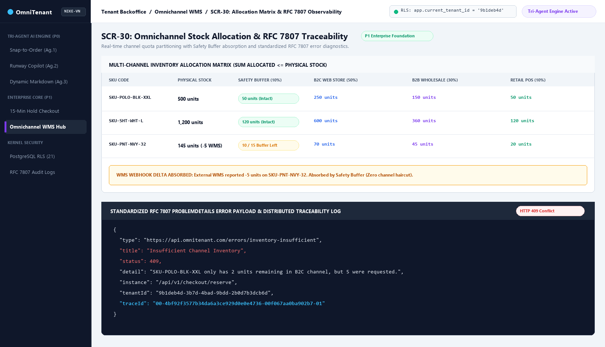
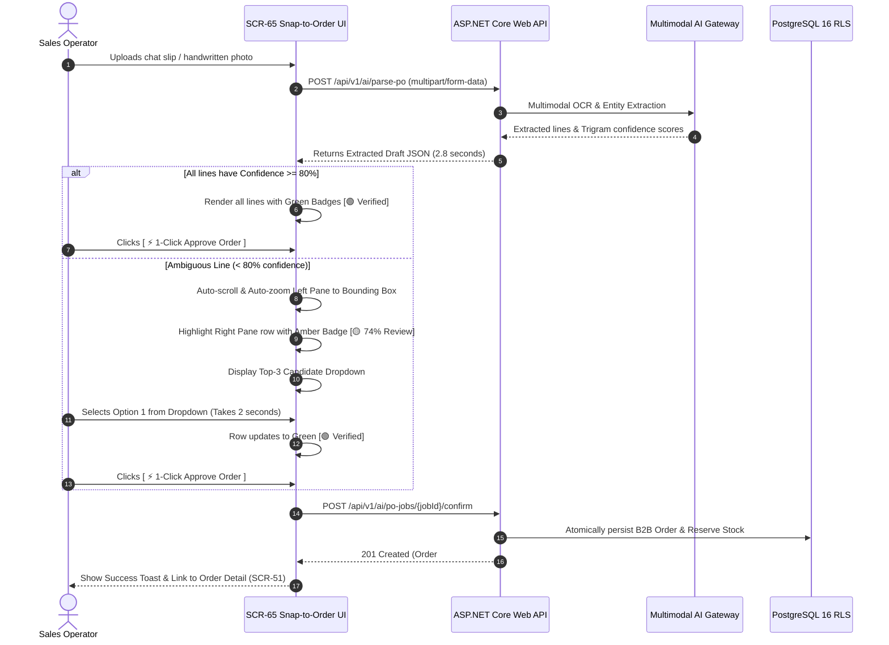
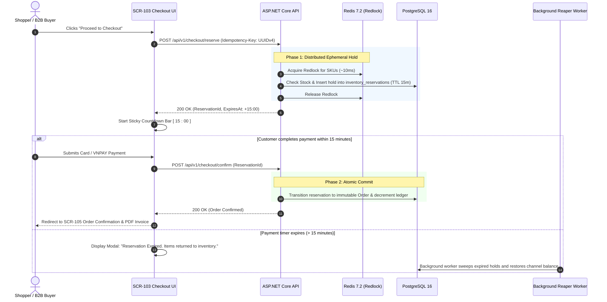

# UI/UX Design Specification, Wireframe Blueprints & Interaction Architecture — OmniTenant V1

> **Status:** APPROVED TARGET V1 SPECIFICATION  
> **Target Platforms:** Tenant Admin Backoffice (Desktop-First, Tablet-Responsive) & Customer Storefront (Mobile-First, Desktop-Optimized)  
> **Related Specifications:**  
> - [04-information-architecture.md](04-information-architecture.md) (Routing, Sitemap, 9-State UI Contract)  
> - [03-use-cases.md](03-use-cases.md) (UC01–UC21 Use Cases & Actors)  
> - [08-invest-requirements.md](08-invest-requirements.md) (INVEST User Stories US01–US21)  
> - [06-acceptance-criteria.md](06-acceptance-criteria.md) (Observable Acceptance Criteria)  
> - [openapi.yaml](api/openapi.yaml) (30 RESTful API Operations)

---

## 1. Executive Summary & Design Principles

OmniTenant is an enterprise-grade Autonomous Commerce Operating System. The UI/UX architecture is engineered around three foundational design tenets:

1. **Management by Exception (Human-on-the-Loop AI):**  
   AI agents (Snap-to-Order, Procurement Copilot, Dynamic Markdown) do not bury users in raw data. The UI surfaces **high-confidence automated drafts** and isolates **low-confidence edge cases** with visual bounding boxes, candidate dropdowns, and 1-click approvals.
2. **Radical Operational Transparency:**  
   High-concurrency events (15-minute stock holds, Redis locks, channel buffer haircuts, automated price rollbacks) are visibly communicated with real-time countdown bars, stock health badges, and audit breadcrumbs.
3. **Zero-Friction B2B & High-Velocity B2C Workflows:**  
   B2B wholesale buyers receive rapid keyboard-first bulk inputs, split-screen verification, and clear volume-tier breakdowns; B2C shoppers experience sub-100ms catalog interactions and guaranteed reservation checkout.

---

## 2. Design System & Style Guide

### 2.1 Color Tokens & Semantic Palette

The visual language balances **Enterprise Stability** (deep slates and cool neutrals) with **AI-Driven Automation Accents** (electric violet and emerald green).

| Token Name | Hex Code | Tailwind Equivalent | Role & Context |
| :--- | :--- | :--- | :--- |
| `--color-surface-bg` | `#F8FAFC` | `bg-slate-50` | Primary app background (light mode) |
| `--color-surface-card` | `#FFFFFF` | `bg-white` | Elevated data cards, tables, modals |
| `--color-surface-sidebar` | `#0F172A` | `bg-slate-900` | Backoffice persistent navigation shell |
| `--color-border-subtle` | `#E2E8F0` | `border-slate-200` | Grid dividers, card borders, tab lines |
| `--color-primary` | `#2563EB` | `bg-blue-600` | Primary CTAs, active tab indicators, links |
| `--color-primary-hover` | `#1D4ED8` | `hover:bg-blue-700` | Interactive hover state for primary buttons |
| `--color-ai-accent` | `#7C3AED` | `bg-violet-600` | AI Tri-Agent badges, automated recommendation banners |
| `--color-ai-glow` | `#DDD6FE` | `bg-violet-100` | Highlighting AI-scanned bounding boxes, active prompts |
| `--color-success` | `#059669` | `text-emerald-600` | High confidence ($\ge 80\%$), in-stock badge, verified order |
| `--color-warning` | `#D97706` | `text-amber-600` | Review needed ($60-79\%$), low stock warning, safety stock breach |
| `--color-danger` | `#DC2626` | `text-red-600` | Critical confidence ($<60\%$), out of stock, reservation expired |

---

### 2.2 Typography & Scale

- **Primary UI Typeface:** `Inter`, `-apple-system`, `BlinkMacSystemFont`, `Segoe UI`, `sans-serif` (legibility at dense data scales).
- **Monospace Code/Data Typeface:** `JetBrains Mono`, `ui-monospace`, `Consolas`, `monospace` (SKUs, UUIDs, trace IDs, currency prices, mathematical formulas).

| Text Style | Size / Line-Height | Weight | Tracking | Usage |
| :--- | :--- | :--- | :--- | :--- |
| **Display Heading** | 28px / 36px | Bold (700) | `-0.02em` | Screen titles, KPI hero metrics |
| **Section Heading** | 20px / 28px | SemiBold (600) | `-0.01em` | Panel titles, modal headers, drawer titles |
| **Subheading** | 15px / 22px | Medium (500) | `0` | Card headers, table section titles |
| **Body Regular** | 13px / 20px | Regular (400) | `0` | Standard table cell text, descriptions |
| **Caption / Meta** | 11px / 16px | Medium (500) | `+0.01em` | Confidence pill tags, timestamps, trace IDs |
| **Data / Numbers** | 13px / 20px | SemiBold (600) | `0` | Currency amounts, stock quantities, SKU codes |

---

### 2.3 Visual Badge & Feedback Components

```text
[Confidence High >= 80%]   -->  [ 🟢 94% Matched ] (bg-emerald-50 text-emerald-700 border-emerald-200)
[Confidence Warn 60-79%]   -->  [ 🟡 74% Review  ] (bg-amber-50 text-amber-700 border-amber-200)
[Confidence Low < 60%]     -->  [ 🔴 48% Unknown ] (bg-red-50 text-red-700 border-red-200)

[Margin Floor Guardrail]   -->  [ 🔒 Margin Floor >= 10% Locked ] (bg-slate-900 text-white)
[15-min Reservation Bar]   -->  [ ⏱️ Reserved for 14:32 (Checkout Guaranteed) ] (bg-blue-50 text-blue-800)
```

---

## 3. Visual UI Mockups & High-Fidelity Screen Blueprints

> **Interactive Prototype Available:** Open [`docs/ui/index.html`](ui/index.html) in any browser to interact live with the Split-Screen OCR Reviewer, Runway Copilot, Dynamic Markdown 10% Margin Guardrail Slider, and 15-Minute Checkout Countdown Timer.

### 3.1 `SCR-65` AI Snap-to-Order Studio (Agent 1 / US19 / P0 Killer)

The **AI Snap-to-Order Studio** utilizes an **Interactive Split-Screen Architecture**. Sales operators ingest raw customer documents (handwritten slips, whiteboard photos, WhatsApp/Zalo chats) on the left pane and verify extracted draft lines on the right pane in under 3 seconds.



```text
+-------------------------------------------------------------------------------------------------------------------------------------------------------+
|  OmniTenant Backoffice  |  Catalog  |  Inventory  |  Orders  | [ AI Operations v ] |  Settings                                [ Tenant: Nike-VN v ] [Admin]|
+-------------------------------------------------------------------------------------------------------------------------------------------------------+
|  AI Snap-to-Order Studio  >  Job #PO-JOB-9842 (Uploaded: 10:42 AM by Zalo Bot)                                                                         |
|  Status: [ 🟡 2 Lines Need Review ]                     Total Lines: 12      Auto-Matched: 10/12      Total Value: 24,500,000 ₫    Processing: 2.8s    |
+-------------------------------------------------------------------------------------------+-----------------------------------------------------------+
|  LEFT PANE: ORIGINAL INGESTED ARTIFACT (Photo / PDF / Chat)                               |  RIGHT PANE: EXTRACTED B2B DRAFT ORDER DATA GRID          |
+-------------------------------------------------------------------------------------------+-----------------------------------------------------------+
|  [ Zoom In + ] [ Zoom Out - ] [ Rotate ] [ Reset View ]       File: zalo_slip_098.jpg     |  Buyer: [ 🏢 Saigon Wholesale Garments Ltd   [Change] ]   |
|  +-------------------------------------------------------------------------------------+  |  Price Tier: [ Tier 2 (Wholesale -15%) ]   Credit: OK     |
|  |                                                                                     |  +-----------------------------------------------------------+
|  |   Hóa đơn lấy sỉ ngày 02/11                                                         |  | Line | Extracted Text      | Matched SKU & Name  | Conf  | Qty |
|  |                                                                                     |  +------+--------------------+---------------------+-------+-----+
|  |   1. Áo polo đen form rộng sz bự: 20 cái  [BOUNDING BOX #1 - GREEN]                 |  |  01  | "polo đen form...  | SKU-POLO-BLK-XXL    |  94%  |  20 |
|  |   2. Sơ mi trắng cổ tàu sz L: 15 cái      [BOUNDING BOX #2 - GREEN]                 |  |      |                    | Polo Classic Black  | [OK]  |     |
|  |                                                                                     |  +------+--------------------+---------------------+-------+-----+
|  |  +-------------------------------------------------------------------------------+  |  |  02  | "sơ mi trắng cổ... | SKU-SHT-WHT-L       |  91%  |  15 |
|  |  | 3. Quần tây âu xanh than ống túm 32: 10 cái   [BOUNDING BOX #3 - AMBER ACTIVE]|  |  |      |                    | Oxford Shirt White  | [OK]  |     |
|  |  +-------------------------------------------------------------------------------+  |  +------+--------------------+---------------------+-------+-----+
|  |   4. Vớ lười xám tiêu: 50 đôi             [BOUNDING BOX #4 - GREEN]                 |  | *03* | "quần tây âu xa... | [ ⚠️ SELECT CANDIDATE v ] | 74% |  10 |
|  |   5. ...                                                                            |  |      |                    | > Option 1: SKU-PNT-NVY-32 (74%) |     |
|  |                                                                                     |  |      |                    |   Option 2: SKU-PNT-BLU-32 (62%) |     |
|  |   [ AUTO-ZOOM TO LINE #3: 150% MAGNIFICATION SHOWN HERE ]                           |  |      |                    |   Option 3: SKU-PNT-BLK-32 (45%) |     |
|  |                                                                                     |  +------+--------------------+---------------------+-------+-----+
|  |                                                                                     |  |  04  | "vớ lười xám ti... | SKU-SCK-GRY-FREE    |  96%  |  50 |
|  |                                                                                     |  +------+--------------------+---------------------+-------+-----+
|  |                                                                                     |  | Subtotal: 24,500,000 ₫    Tier 2 Discount: -3,675,000 ₫   |
|  |                                                                                     |  | Tax (8% VAT): 1,666,000 ₫  FINAL TOTAL: 22,491,000 ₫      |
|  +-------------------------------------------------------------------------------------+  +-----------------------------------------------------------+
|  Tip: Press [Tab] to cycle ambiguous lines. Press [1-3] to accept candidate.              |  [ Discard Job ]   [ Save Draft ]   [ ⚡ 1-Click Approve Order ]|
+-------------------------------------------------------------------------------------------+-----------------------------------------------------------+
```

---

### 3.2 `SCR-66` AI Inventory Procurement Copilot (Agent 2 / US20 / P0 Killer)

The **Procurement Copilot Console** tracks SKU depletion velocity over a rolling 30-day window, dynamically calculates **Runway Days** ($\frac{\text{AvailableStock}}{\text{DailyBurnRate}}$), and automatically prepares vendor Purchase Orders before stockout horizons are breached.



```text
+-------------------------------------------------------------------------------------------------------------------------------------------------------+
|  OmniTenant Backoffice  |  Catalog  |  Inventory  |  Orders  | [ AI Operations v ] |  Settings                                [ Tenant: Nike-VN v ] [Admin]|
+-------------------------------------------------------------------------------------------------------------------------------------------------------+
|  AI Inventory Procurement Copilot                                                                                     [ 🔄 Refresh Telemetry ] [Export]|
|  Automated continuous stockout prevention and vendor replenishment pipeline.                                                                           |
+-------------------------------------------------------------------------------------------------------------------------------------------------------+
|  TELEMETRY KPI CARDS                                                                                                                                  |
|  +-----------------------------+ +-----------------------------+ +-----------------------------+ +-------------------------------------------------+  |
|  | SKUs Monitored: 1,420       | | Imminent Stockouts (<7d): 3 | | Rolling 30D Velocity: 242/d | | Auto-Drafted Supplier POs Pending: 2            |  |
|  | 🟢 98.2% In-Stock Health    | | 🔴 Action Required Immed.   | | 📈 +14.2% vs previous mo.   | | Value: 184,000,000 ₫ (Lead-time Protected)       |  |
|  +-----------------------------+ +-----------------------------+ +-----------------------------+ +-------------------------------------------------+  |
+-------------------------------------------------------------------------------------------------------------------------------------------------------+
|  DEPLETION HORIZON & REORDER MATRIX                                                              [ Filter: High Risk (<14d) v ] [ Search SKU...     ] |
+-------------------------------------------------------------------------------------------------------------------------------------------------------+
| SKU Code          | Product Variant Name        | Current Stock | Daily Velocity (30D) | Runway Days | Supplier Lead Time | Status     | Action       |
+-------------------+-----------------------------+---------------+----------------------+-------------+--------------------+------------+--------------+
| SKU-POLO-BLK-XL   | Classic Black Polo - XL     | 42 units      | 14.0 units / day     | 🟢 3.0 Days | 7 Days (VN-Tex)    | 🔴 CRITICAL| [Review PO ⚡]|
| SKU-SHT-WHT-M     | Oxford Formal White - M     | 85 units      | 12.1 units / day     | 🟡 7.0 Days | 7 Days (HanoiGarment)| 🟡 WARNING | [Draft PO ]  |
| SKU-TSH-NVY-L     | Slim Crewneck Navy - L      | 310 units     | 18.5 units / day     | 🟢 16.7 Days| 5 Days (VN-Tex)    | 🟢 HEALTHY | [View Trends]|
| SKU-PNT-GRY-32    | Chino Trousers Grey - 32    | 1,200 units   | 1.2 units / day      | 🔵 1,000 D  | 10 Days (DongNai)  | 💤 STAGNANT| [Pass to Ag3]|
+-------------------+-----------------------------+---------------+----------------------+-------------+--------------------+------------+--------------+
|                                                                                                                                                       |
|  +-- DRAWER OVERLAY (TRIGGERED BY "Review PO ⚡"): PRE-POPULATED PURCHASE ORDER #PO-DRAFT-2026-081 -------------------------------------------------+  |
|  | Supplier: Vietnam Textile Group (VN-Tex)       Target Warehouse: WH-HCM-CENTRAL        Payment Terms: Net 30                             |  |
|  | Recommended Restock Qty: 300 units (Covers 21 Days Buffer + 7 Days Lead Time)          Unit Cost: 180,000 ₫        PO Total: 54,000,000 ₫  |  |
|  | AI Rationale: "Burn rate accelerated 35% due to seasonal promo. Lead time is 7 days. Replenishing now guarantees zero stockout on Day 4."      |  |
|  | [ Cancel Drawer ]                                                                          [ 📥 Download PDF ]  [ 🚀 1-Click Dispatch to Supplier ]|  |
|  +--------------------------------------------------------------------------------------------------------------------------------------------------+  |
+-------------------------------------------------------------------------------------------------------------------------------------------------------+
```

---

### 3.3 `SCR-67` AI Dynamic Markdown & Dead-Stock Liquidation Console (Agent 3 / US21 / P0 Killer)

The **Dynamic Markdown Console** algorithmically discovers trapped working capital in stagnant SKUs ($>30$ days untouched, $>50\%$ velocity drop) and formulates flash sales while strictly enforcing an algorithmic **Gross Margin Floor $\ge 10\%$**.



```text
+-------------------------------------------------------------------------------------------------------------------------------------------------------+
|  OmniTenant Backoffice  |  Catalog  |  Inventory  |  Orders  | [ AI Operations v ] |  Settings                                [ Tenant: Nike-VN v ] [Admin]|
+-------------------------------------------------------------------------------------------------------------------------------------------------------+
|  AI Dynamic Markdown & Dead-Stock Liquidation Console                                                                                                 |
|  Algorithmic working capital reclamation safeguarding Gross Margin Floor >= 10%.                                                                      |
+-------------------------------------------------------------------------------------------------------------------------------------------------------+
|  LIQUIDATION TELEMETRY                                                                                                                                |
|  +-------------------------------------+ +-------------------------------------+ +---------------------------------------------------------------+  |
|  | Trapped Capital: 420,500,000 ₫      | | Stagnant SKUs Detected: 14          | | Guardrail Rule: Gross Margin >= 10.0% (Hard Law)                |  |
|  | 💤 0 units sold in last 30 days     | | Holding Cost: ~12,500,000 ₫/month   | | 🔒 System physically rejects any campaign violating margin floor|  |
|  +-------------------------------------+ +-------------------------------------+ +---------------------------------------------------------------+  |
+-------------------------------------------------------------------------------------------------------------------------------------------------------+
|  STAGNANT INVENTORY CLEARANCE PROPOSALS                                                                                                               |
+-------------------------------------------------------------------------------------------------------------------------------------------------------+
| SKU Code          | Name & Variant             | Stagnant Stock | Unit Cost | Current MSRP | Proposed Markdown | Projected Margin | Action            |
+-------------------+----------------------------+----------------+-----------+--------------+-------------------+------------------+-------------------+
| SKU-JKT-YEL-M     | Puffer Jacket Mustard - M  | 145 units      | 350,000 ₫ | 890,000 ₫    | 499,000 ₫ (-44%)  | 🟢 29.8% (>10%)  | [Simulate & Run ⚡]|
| SKU-PNT-GRY-32    | Chino Trousers Grey - 32   | 420 units      | 220,000 ₫ | 550,000 ₫    | 275,000 ₫ (-50%)  | 🟢 20.0% (>10%)  | [Simulate & Run ⚡]|
| SKU-CAP-ORG-OS    | Neon Orange Trucker Cap    | 280 units      | 60,000 ₫  | 150,000 ₫    | 69,000 ₫ (-54%)   | 🟡 13.0% (>10%)  | [Simulate & Run ⚡]|
+-------------------+----------------------------+----------------+-----------+--------------+-------------------+------------------+-------------------+
|                                                                                                                                                       |
|  +-- MODAL OVERLAY: CAMPAIGN SIMULATOR & 1-CLICK DEPLOYMENT (SKU-JKT-YEL-M) ------------------------------------------------------------------------+  |
|  | Markdown Depth Slider: [---------o--------] -44% (New Price: 499,000 ₫)                    Projected Sell-Through Rate: 85% in 72 hours           |  |
|  | Cost of Goods Sold (COGS): 350,000 ₫        Gross Margin: +149,000 ₫ (+29.8%)               Working Capital Reclaimed: 61,377,000 ₫                |  |
|  |                                                                                                                                                   |  |
|  | Algorithmic Guardrail:                                                                                                                            |  |
|  | [ 🔒 MARGIN FLOOR VERIFIED: 29.8% >= 10.0% MINIMUM FLOOR ]                                                                                          |  |
|  | Note: If you attempt to discount below 385,000 ₫ (10% margin), the deploy button locks and displays an error code `ERR_MARGIN_FLOOR_VIOLATION`.   |  |
|  |                                                                                                                                                   |  |
|  | Automated Rollback Timer: [ 72 Hours (3 Days) v ] (Price automatically reverts to 890,000 ₫ on Nov 5, 2026, 12:00 PM)                             |  |
|  | Channels to Publish: [X] B2C Storefront Flash Sale Banner    [X] B2B Wholesale Clearance Broadcast Email                                          |  |
|  | [ Dismiss ]                                                                                [ 🚀 Activate Campaign with Auto-Rollback ]            |  |
|  +--------------------------------------------------------------------------------------------------------------------------------------------------+  |
+-------------------------------------------------------------------------------------------------------------------------------------------------------+
```

---

### 3.4 `SCR-103` High-Concurrency Checkout & 15-Minute Reservation Hold (Storefront / US08, US14 / P0 Killer)

During viral flash sales, customers must have confidence that their inventory is reserved while they type credit card numbers. The **Two-Phase Reservation UI** features a persistent sticky countdown banner and real-time state feedback.



```text
+-------------------------------------------------------------------------------------------------------------------------------------------------------+
|  NIKE VIETNAM OFFICIAL STOREFRONT                                                          [ 🔍 Search products... ]   [ Cart (2) ]  [ User Account ] |
+-------------------------------------------------------------------------------------------------------------------------------------------------------+
|  +-------------------------------------------------------------------------------------------------------------------------------------------------+  |
|  |  ⏱️ INVENTORY SECURELY RESERVED FOR:  [ 14 : 28 ]  (Phase 1 Distributed Hold Active)                                                             |  |
|  |  Your items are locked exclusively for you. You have 14 minutes and 28 seconds to complete payment before items return to general stock.        |  |
|  +-------------------------------------------------------------------------------------------------------------------------------------------------+  |
|                                                                                                                                                       |
|  CHECKOUT — STEP 2 OF 3: PAYMENT & CONFIRMATION                                                                                                       |
|                                                                                                                                                       |
|  Shipping Address:                                                          Order Summary:                                                            |
|  Nguyen Van A - 0901234567                                                  +----------------------------------------------------------------------+  |
|  72 Le Loi, Ben Nghe, District 1, Ho Chi Minh City                          | 1x Classic Black Polo - XL (SKU-POLO-BLK-XXL)              550,000 ₫ |  |
|  [ Edit Shipping Address ]                                                  | 1x Puffer Jacket Mustard - M (SKU-JKT-YEL-M) [FLASH DEAL]  499,000 ₫ |  |
|                                                                             +----------------------------------------------------------------------+  |
|  Select Payment Method:                                                     | Subtotal:                                                1,049,000 ₫ |  |
|  (o) Credit / Debit Card (Visa, Mastercard, JCB)                            | Flash Markdown Discount:                                  -391,000 ₫ |  |
|  ( ) VNPAY QR Code Instant Scan                                             | Shipping:                                                   30,000 ₫ |  |
|  ( ) B2B Corporate Credit Account (Available: 45,000,000 ₫)                 | VAT (8%):                                                   55,040 ₫ |  |
|                                                                             | -------------------------------------------------------------------- |  |
|  Card Information:                                                          | TOTAL AMOUNT:                                              743,040 ₫ |  |
|  +-----------------------------------------------------------------------+  +----------------------------------------------------------------------+  |
|  | Card Number: [ 4111 •••• •••• 1234                                  ] |  🔒 Bank-Grade Concurrency Protection:                                     |  |
|  | Exp: [ 12/28 ]   CVV: [ ••• ]   Name on Card: [ NGUYEN VAN A        ] |  Guaranteed zero-overselling via Redis Redlock & PostgreSQL RLS.           |  |
|  +-----------------------------------------------------------------------+  Idempotency Key: `idem_9f81a7b...` (Zero risk of double charge)          |
|                                                                                                                                                       |
|  [ < Return to Cart ]                                                                             [ 💳 Complete Payment & Finalize Order (743,040 ₫) ]|
+-------------------------------------------------------------------------------------------------------------------------------------------------------+
```

---

### 3.5 `SCR-30` Omnichannel Inventory Allocation Matrix (WMS / US07, US15 / P1 Core)

The **Inventory Allocation Matrix** prevents overselling across channels (Online B2C, Wholesale B2B, Retail Stores) and provides visual indicators when synchronization discrepancies occur.



```text
+-------------------------------------------------------------------------------------------------------------------------------------------------------+
|  OmniTenant Backoffice  |  Catalog  | [ Inventory v ] |  Orders  |  AI Operations  |  Settings                    [ Tenant: Nike-VN v ] [Admin]       |
+-------------------------------------------------------------------------------------------------------------------------------------------------------+
|  Omnichannel Stock Allocation Hub                                                                 [ + Manual Rebalance ] [ Sync Conflict Queue (1) ]|
+-------------------------------------------------------------------------------------------------------------------------------------------------------+
| SKU Code          | Total Physical | Safety Buffer | Allocated: B2C Web | Allocated: B2B Wholesale | Allocated: Retail Stores | Unallocated | Actions  |
+-------------------+----------------+---------------+--------------------+--------------------------+--------------------------+-------------+----------+
| SKU-POLO-BLK-XL   | 500 units      | 50 units (10%)| 250 units          | 150 units                | 50 units                 | 0 units     | [Edit ⚙️]|
| SKU-SHT-WHT-M     | 1,200 units    | 120 units     | 600 units          | 380 units                | 100 units                | 0 units     | [Edit ⚙️]|
| SKU-JKT-YEL-M     | 300 units      | 30 units      | 170 units          | 70 units                 | 30 units                 | 0 units     | [Edit ⚙️]|
| SKU-PNT-NVY-32    | 150 units      | 15 units      | 70 units           | 45 units                 | 20 units                 | 0 units     | [Edit ⚙️]|
+-------------------+----------------+---------------+--------------------+--------------------------+--------------------------+-------------+----------+
|                                                                                                                                                       |
|  ⚠️ SYNC CONFLICT BANNER: External WMS reported deficit on SKU-PNT-NVY-32 (-5 units).                                                                 |
|  Deficit absorbed into Safety Stock Buffer (Buffer remaining: 10 units). No channels haircut.               [ View Reconciliation Queue (SCR-33) -> ] |
+-------------------------------------------------------------------------------------------------------------------------------------------------------+
```

---

## 4. End-to-End User Experience Flows (Wireflows)

### 4.1 Wireflow 1: AI Snap-to-Order Exception Handling Flow



---

### 4.2 Wireflow 2: High-Concurrency Two-Phase Checkout Flow



---

## 5. UI Responsive & Accessibility Standards (WCAG 2.1 AA)

| Accessibility Criterion | Implementation Specification in OmniTenant |
| :--- | :--- |
| **Color Contrast** | All body text achieves $\ge 4.5:1$ contrast against card backgrounds. Status pill text achieves $\ge 3:1$ against pill background fills. |
| **Keyboard Traversal** | Complete keyboard navigation support (`Tab`, `Shift+Tab`, `Enter`, `Escape`). Modals trap focus and close on `Escape`. |
| **Screen Reader Aria** | AI confidence indicators utilize `aria-label="Confidence score 74 percent, requires human review"`. The 15-minute countdown updates polite screen readers using `aria-live="polite"`. |
| **Touch Optimization** | All mobile buttons and quantity steppers feature minimum hit targets of $44 \times 44$ CSS pixels. |
| **Form Safety** | Mutating actions (e.g. 1-Click Approve, Place Order) automatically disable inputs and display inline loading spinners to prevent double-submit anomalies. |

---

## 6. Traceability: Requirements to UI Specifications

| User Story | Screen ID | Wireframe Section | Primary Interaction |
| :--- | :--- | :--- | :--- |
| **US07** | `SCR-30` | Section 3.5 | Omnichannel channel allocation matrix with buffer threshold indicators. |
| **US08, US14** | `SCR-103` | Section 3.4 & 4.2 | 15-minute sticky reservation countdown with Redlock concurrency guarantees. |
| **US10** | `SCR-52` | Section 3.1 | B2B credit limit check and over-limit authorization modal. |
| **US19 (P0)** | `SCR-65` | Section 3.1 & 4.1 | Split-screen OCR document inspector with bounding box auto-zoom & candidate dropdown. |
| **US20 (P0)** | `SCR-66` | Section 3.2 | Stockout Runway Days telemetry and auto-populated vendor PO drawer. |
| **US21 (P0)** | `SCR-67` | Section 3.3 | Stagnant SKU clearance simulator with locked Gross Margin Floor $\ge 10\%$. |

---

*This specification is maintained under configuration management and maps 1:1 with backend entities defined in `src/database/schema.sql` and API contracts in `docs/api/openapi.yaml`.*

