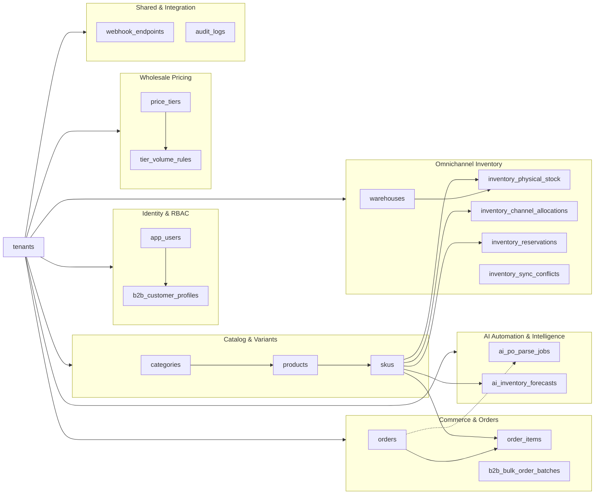
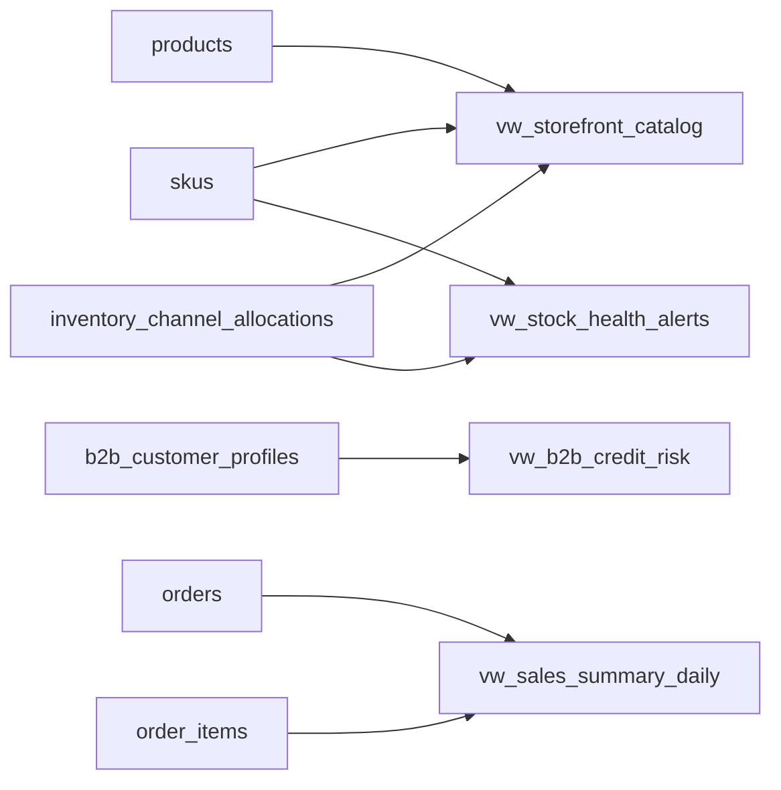
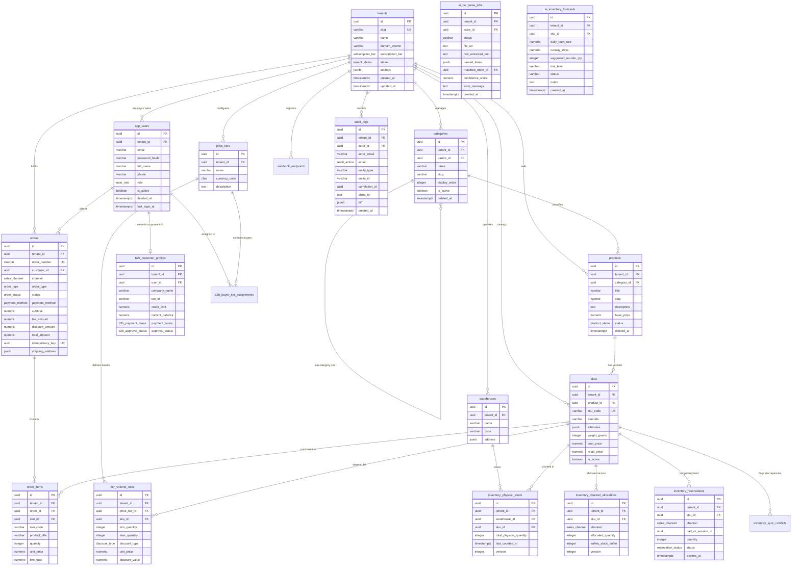

# Data Diagram & Entity Relationships — OmniTenant V1

> Design status: TARGET V1
>
> Runtime status: TARGET SCHEMA SPECIFICATION

PostgreSQL schema for **OmniTenant**.

This document outlines the entity relationships, relational cardinality, enumerated data types, database reporting views, and comprehensive ER diagrams for the platform.

Design files: [schema.sql](../src/database/schema.sql) · [05-data-model.md](05-data-model.md) · [04-information-architecture.md](04-information-architecture.md).

---

## 1. Domain Group Relationships

The architecture isolates entities into 6 cohesive domains. Every domain entity is strictly bound to its parent `tenants` organization.

---

## 2. Enumerated Types (Enums)

| Enum Type | Allowed Values | Usage & Business Context |
|---|---|---|
| `subscription_tier` | `FREE`, `PRO`, `ENTERPRISE` | Tenant resource quota and platform feature gating. |
| `tenant_status` | `ACTIVE`, `SUSPENDED`, `ARCHIVED` | Tenant organization operational lifecycle state. |
| `user_role` | `SUPERADMIN`, `TENANT_OWNER`, `WAREHOUSE_OPERATOR`, `B2B_BUYER`, `B2C_SHOPPER` | Role-based access control (RBAC) authorization level. |
| `b2b_approval_status`| `PENDING`, `APPROVED`, `REJECTED`, `SUSPENDED` | Corporate buyer credit line verification status. |
| `b2b_payment_terms` | `PREPAID`, `NET_15`, `NET_30`, `NET_60` | Agreed B2B credit settlement terms. |
| `product_status` | `DRAFT`, `PUBLISHED`, `ARCHIVED` | Lifecycle visibility on storefront catalog. |
| `sales_channel` | `ONLINE_B2C`, `WHOLESALE_B2B`, `RETAIL_OUTLET` | Dedicated inventory allocation quota channel. |
| `discount_type` | `PERCENTAGE`, `FIXED_PRICE` | Calculation rule for tiered wholesale volume breaks. |
| `reservation_status`| `HELD`, `COMMITTED`, `EXPIRED`, `CANCELLED` | Two-phase checkout temporary stock hold lifecycle. |
| `conflict_status` | `OPEN`, `RESOLVED`, `IGNORED` | External WMS stock discrepancy resolution status. |
| `order_status` | `PENDING_PAYMENT`, `RESERVED`, `PAID`, `ALLOCATED`, `SHIPPED`, `DELIVERED`, `CANCELLED` | Commercial order progression state. |
| `order_type` | `RETAIL`, `B2B_PURCHASE_ORDER` | Direct retail cart checkout vs. corporate PO checkout. |
| `payment_method` | `CREDIT_CARD`, `B2B_CREDIT_TERMS`, `BANK_TRANSFER`, `CASH_ON_DELIVERY` | Settlement method recorded on order. |
| `audit_action` | `CREATE`, `UPDATE`, `SOFT_DELETE`, `RESTORE`, `RECONCILE`, `CREDIT_OVERRIDE`, `LOGIN` | Business mutation taxonomy in compliance logs. |

---

## 3. Database Views (Analytical Aggregates)

Views provide pre-aggregated reporting metrics and read-optimized models without locking active transactional rows:

---

## 4. Comprehensive Entity-Relationship Diagram (ERD)

---

**Related:** [Data Model Specification](05-data-model.md) · [Database Schema DDL](../src/database/schema.sql)
