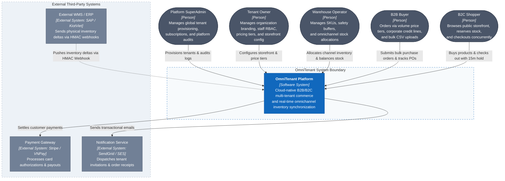

# C1 — System Context

> **Status:** Architecture Baseline · **Level:** C4 Level 1

The System Context diagram establishes the boundary of the **OmniTenant Platform**, identifying the human actors interacting with the system and the external third-party systems integrated via protocols.

---

## 1. System Context Diagram

---

## 2. External Actors & Responsibilities

| Actor | Role Code | Responsibility within OmniTenant |
|---|---|---|
| **Platform SuperAdmin** | `SUPERADMIN` | Platform root owner. Provisions new isolated tenant organizations, sets resource limits, and reviews global audit logs. |
| **Tenant Owner** | `TENANT_OWNER` | Merchant brand administrator. Configures custom domains, price tiers, corporate credit limits, and staff RBAC. |
| **Warehouse Operator** | `WAREHOUSE_OPERATOR` | Fulfillment specialist. Tracks physical SKU stock, adjusts safety buffers, allocates quotas, and reconciles count divergence. |
| **B2B Buyer** | `B2B_BUYER` | Corporate wholesale client. Orders bulk merchandise at contract volume discount prices using credit terms or POs. |
| **B2C Shopper** | `B2C_SHOPPER` | Retail customer. Purchases products on brand storefronts with high-concurrency stock reservation guarantees. |

---

## 3. External System Interfaces

| External System | Integration Protocol | Interaction Purpose |
|---|---|---|
| **Payment Gateway** (Stripe / VNPay) | HTTPS REST API | Processes 3D-Secure credit card token authorizations during Phase 2 of checkout. |
| **External WMS / ERP** (KiotViet / SAP) | Inbound HMAC Webhook | Delivers machine-to-machine physical stock deltas; verified by HMAC SHA-256 and `Idempotency-Key`. |
| **Notification Service** (SendGrid) | SMTP / REST API | Dispatches tenant invitation links, password resets, low-stock threshold warnings, and PDF invoice receipts. |
