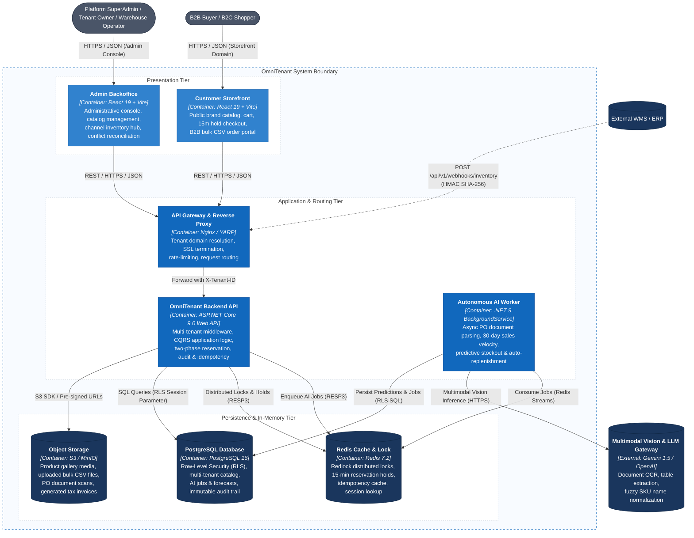

# C2 — Container

> **Status:** Architecture Baseline · **Level:** C4 Level 2

The Container diagram zooms into the **OmniTenant Platform**, depicting the runtime executables, single-page web applications, backend services, caching layers, data stores, and communication protocols.

---

## 1. Container Architecture Diagram

---

## 2. Container Inventory & Technology Stack

| Container | Technology | Operational Responsibility |
|---|---|---|
| **Customer Storefront** | React 19, TypeScript, Vite | Single-page client for retail and wholesale buyers. Renders dynamic price tiers, live stock availability, 15-min countdown checkout, and CSV upload. |
| **Admin Backoffice** | React 19, TypeScript, Vite | Operational dashboard for Tenant Owners and Warehouse Operators. High-density data grids, SKU variant drawer, allocation matrix, and AI Copilot recommendations. |
| **API Gateway / Proxy** | Nginx / YARP (C#) | Ingress router. Extracts subdomain or custom CNAME (`{tenant-slug}.omnitenant.com`), injects `X-Tenant-ID`, terminates TLS, and enforces rate limits. |
| **OmniTenant Backend API** | ASP.NET Core 9.0 (.NET 9) | Core business engine implementing Clean Architecture. Validates tokens, coordinates Two-Phase Stock Reservation, evaluates volume pricing, and logs audits. |
| **Autonomous AI Worker** | .NET 9 BackgroundService | Asynchronous job consumer. Orchestrates PO document processing, calculates rolling stock consumption runways, and raises predictive replenishment alerts. |
| **Redis Cache & Lock** | Redis 7.2 | In-memory distributed lock manager (`Redlock`), ephemeral 15-minute reservation hold store, Redis Streams job queue, and 24-hour `Idempotency-Key` replay cache. |
| **PostgreSQL Database** | PostgreSQL 16 | Primary ACID relational database. Enforces tenant data segregation via native Row-Level Security (`app.current_tenant_id`), catalogs, orders, and AI forecast logs. |
| **Object Storage** | S3 / MinIO | Scalable object storage for product images, uploaded bulk CSV batches, uploaded PO document scans, and rendered PDF tax invoices. |
| **Multimodal Vision & LLM** | Google Gemini / OpenAI | External AI gateway providing document OCR, handwritten text extraction, and entity normalization for unstructured B2B purchase orders. |

---

## 3. Inter-Container Communication Protocols

- **Browser to API Gateway**: Secure HTTPS (TLS 1.3), JSON payloads, Bearer JWT authorization.
- **Backend API to Redis**: Redis Serialization Protocol (RESP3) via StackExchange.Redis connection multiplexer. Average lock acquisition latency < 2ms.
- **Backend API to PostgreSQL**: TCP/IP PostgreSQL wire protocol via Npgsql / Entity Framework Core. Session scoped via `SET LOCAL app.current_tenant_id = :tenantId`.
- **Backend API to Object Storage**: AWS S3 REST API via AWSSDK.S3 using pre-signed upload/download URLs.
- **AI Worker to Multimodal LLM**: Secure HTTPS REST API with structured JSON output schema enforcement. Latency bounded by streaming inference SLAs.
