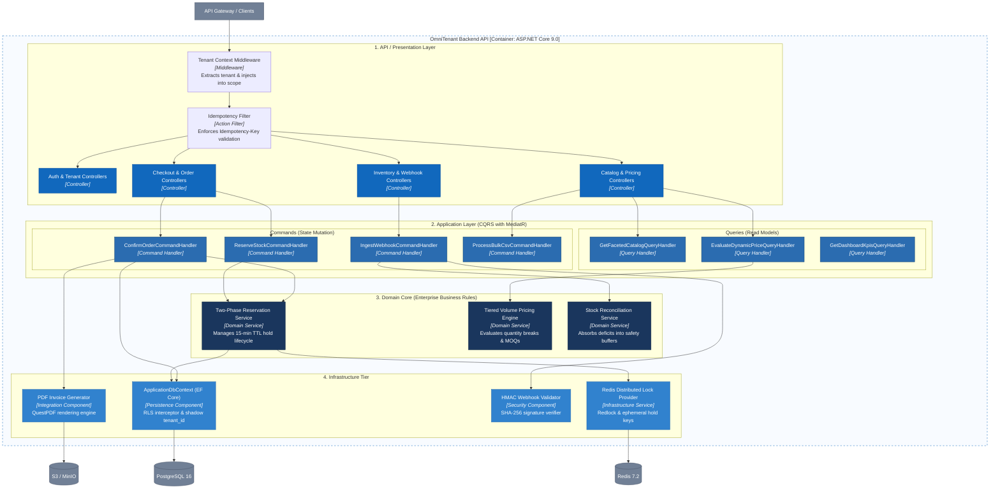

# C3 — Component (.NET Backend Architecture)

> **Status:** Architecture Baseline · **Level:** C4 Level 3

The Component diagram zooms into the **OmniTenant Backend API** container, revealing its modular design following **Clean Architecture** and **CQRS (Command Query Responsibility Segregation)**.

---

## 1. Component Architecture Diagram

---

## 2. Component Descriptions by Clean Architecture Layer

### 1. Presentation & API Layer
- **Tenant Context Middleware**: Extracts `tenant_id` from JWT claims or `X-Tenant-ID` header and initializes the scoped `ITenantContext` provider.
- **Idempotency Filter**: Intercepts mutating requests, queries Redis for duplicate in-flight or cached results, and prevents double execution.
- **REST Controllers**: Strongly typed ASP.NET Core controllers mapping HTTP verbs to MediatR Commands/Queries and formatting output as RFC 7807 `ProblemDetails`.

### 2. Application Layer (CQRS)
- **`ReserveStockCommandHandler`**: Executes Phase 1 of checkout. Coordinates distributed locking and persists 15-minute temporary holds.
- **`ConfirmOrderCommandHandler`**: Executes Phase 2 of checkout. Commits stock reservations to confirmed orders, updates B2B credit balances, and emits `OrderPlacedEvent`.
- **`IngestWebhookCommandHandler`**: Processes inbound WMS deltas, triggers auto-rebalancing against safety buffers, and routes discrepancies to the conflict queue.
- **`EvaluateDynamicPriceQueryHandler`**: Dynamically calculates the optimal unit price given a line-item quantity, SKU, and customer wholesale tier.

### 3. Domain Layer
- **Two-Phase Reservation Service**: Pure domain logic enforcing zero-overselling invariants:
  $$\text{AllocatedQuantity} - \text{SafetyBuffer} \ge \text{RequestedQuantity}$$
- **Tiered Volume Pricing Engine**: Evaluates nested price breaks, MOQ thresholds, and tier assignments.
- **Stock Reconciliation Service**: Determines whether external stock deficits can be absorbed by the safety buffer or require emergency channel allocation haircuts.

### 4. Infrastructure Layer
- **Redis Distributed Lock Provider**: Wraps Redlock algorithms using StackExchange.Redis with automatic lease renewal and deadlock prevention.
- **`ApplicationDbContext` (EF Core)**: Custom database context with a DbConnection interceptor that automatically executes `SET LOCAL app.current_tenant_id = :id` on every opened SQL connection.
- **HMAC Webhook Validator**: Computes cryptographic HMAC SHA-256 signatures over request byte streams to guarantee machine-to-machine authenticity.
- **PDF Invoice Generator**: Renders pixel-perfect, compliant B2B/B2C tax invoices using QuestPDF.
