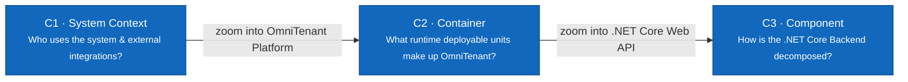

# C4 Architecture Model — OmniTenant

> **Status:** Architecture Baseline · **Target Version:** V1 · **Audience:** Developers, Architects, Reviewers

The architecture documentation follows the **C4 Model** (Simon Brown), zooming progressively from the external context down to software components:

---

## Architectural Hierarchy

| Level | Document | Scope & Focus |
|---|---|---|
| **C1** | [01-system-context.md](01-system-context.md) | Platform boundary, 5 user roles, external Payment Gateways, WMS/ERP, and Notification services. |
| **C2** | [02-container.md](02-container.md) | Runtime containers: React Storefront, React Backoffice, ASP.NET Core Web API, Redis Distributed Lock/Cache, PostgreSQL (RLS), and S3 Object Storage. |
| **C3** | [03-component.md](03-component.md) | Clean Architecture decomposition: API Controllers, CQRS Application Handlers, Domain Entities & Services, Redis Lock Providers, and EF Core Repositories. |

---

## Key Architectural Principles

1. **Strict Multi-Tenant Row-Level Segregation**: Database queries are sandboxed by PostgreSQL RLS (`tenant_id = current_tenant_scope()`), guaranteeing zero cross-tenant leakage.
2. **Two-Phase Concurrency Control**: Checkout requests acquire Redis Redlock distributed locks before updating atomic inventory balances with 15-minute temporary holds (TTL).
3. **Idempotency & Webhook Integrity**: All mutating commerce transactions mandate an `Idempotency-Key` header, while external WMS integration payloads are verified via HMAC SHA-256 signatures.

---

**Related:** [Use Case Specifications](../../03-use-cases.md) · [Database Model](../../05-data-model.md) · [OpenAPI Contract](../../api/README.md)
